<div align="center">

  

  <p>
    A free, open-source media app for Windows, <del>macOS, and Linux</del>.
    <br />
    Bring your own sources. NuvioDeck turns them into a library with artwork, ratings, subtitles, and your place saved on every screen  but with full controller support for Windows and Handhelds.
  </p>

  [GitHub releases](https://github.com/kllakm/NuvioDeck/releases/) · [Support NuvioDeck](https://buymeacoffee.com/enufstyle)

</div>

---

## About This Fork: NuvioDeck (Windows 11 Controller & Handheld Edition)

This fork, **NuvioDeck**, is purpose-built to bring a first-class, **native Windows 11 controller & 10-foot / handheld experience** to Nuvio Desktop (ideal for Steam Deck Windows installations, HTPCs, living-room setups, Xbox/PlayStation/Switch controllers on PC, and Windows handhelds like ROG Ally, Legion Go, and Claw).

### Key Features of NuvioDeck:
- **Universal Windows 11 Controller Support:** Seamless hot-plugging and low-latency input polling across XInput, DirectInput, and HID controllers (Xbox, PlayStation DualSense/DualShock 4, Nintendo Switch Pro/Joy-Con, and generic gamepads), normalized internally to standard Windows Xbox controller conventions.
- **Zero-Friction Input Switching & Auto-Hide Mouse Cursor:** Automatically hides the system mouse cursor and suppresses passive hover states the moment you touch any controller stick, trigger, or button—and immediately restores the cursor as soon as you move or click the mouse or press a key.
- **Full 2D Spatial Navigation & Fluid Scrolling:** Complete D-Pad and analog stick navigation across the sidebar, hero banners, horizontal carousels, grids, detail screens, stream pickers, settings, dialogs, and the native desktop video player + WebView2 OSD with edge-triggered viewport-aware smooth scrolling.
- **Dynamic Xbox-Glyph Controller Hint Toolbar:** Context-aware on-screen button prompts using Xbox-style outlined glyphs (`A`, `B`, `X`, `Y` with colored rings and cap-height centered letters; `LB`, `RB`, `LT`, `RT`, `LS`, `RS`, `D-Pad`, `View`, `Menu` with crisp white outlines and labels) inside a rounded-rectangle semi-transparent dark backdrop (`RoundedCornerShape(8.dp)` / `rgba(16, 16, 18, 0.68)`) that appear automatically during controller use, with a 3.5s inactivity auto-hide timer during video playback.
- **3-Tier Media Player OSD Navigation & Multi-Rail Subtitles:**
  - Full spatial D-Pad navigation across the Player OSD: Tier 0 (header buttons), Tier 1 (seekbar scrubber with 10s step scrubbing), and Tier 2 (bottom playback controls).
  - Multi-rail D-Pad navigation for Subtitles (Languages <-> Subtitles <-> Style) with DOM-tearing protection.
  - Sequential B button navigation: first press dismisses the OSD overlay; second press cleanly returns to the media details page without disrupting fullscreen display mode.
- **Inverted High-Contrast Media "Play" Action Button:** High-contrast inverted focus styling on movie and TV show details screens—flipping to a sleek black background (`#0D0E15`) with bright white text/icon and a crisp 2.dp white border when controller-focused.
- **Netflix-Style Profile Selection & Smooth Animated Exit:**
  - Modern translucent filled card highlights (`Color.White.copy(alpha = 0.15f)`) and top-left brand wordmark alignment matching modern streaming interfaces.
  - Immediate animated fade-out (`alpha: 1f -> 0f`) and gentle scale expansion (`scale: 1.0f -> 1.04f`) on avatar selection, with a polished `AppGate` overlay exit animation (`fadeOut(500) + scaleOut(1.03f)`) for a seamless, cinematic transition into the app.
- **Anti-Banding Display:** 128x128 triangular-distribution micro-dither texture and unified deep cinematic wine/crimson gradient eliminating 8-bit/10-bit banding across 1080p, 1440p, and 4K displays.
- **Default Auto-Stream Selection:** Automatically pre-selects and plays the first available high-quality stream source (`StreamAutoPlayMode.FIRST_STREAM`) upon stream load for streamlined, couch-ready playback.
- **High-Performance Desktop Engine & Instant Image Caching:**
  - **512MB Persistent Disk Cache:** Dedicated Okio-backed disk cache in `%LOCALAPPDATA%\NuvioDeck\Cache\image_cache` ensuring media posters, thumbnails, and backdrops load in 1–3ms from local disk on launch and scroll without repetitive network fetching.
  - **Zero Draw-Thread Overhead:** Streamlined image downsampling utilizing GPU texture units with hardware trilinear mipmapping (`FilterQuality.Medium`), eliminating CPU rasterization bottlenecks from Compose's `onDraw` pass.
  - **Low-Latency G1GC & High-Refresh VSync:** Tuned JVM parameters (`-XX:+UseG1GC -XX:MaxGCPauseMillis=16 -XX:+UseStringDeduplication`) and Skiko display synchronization (`-Dskiko.fps=-1 -Dskiko.vsync=true`) eliminating micro-stutters and unlocking buttery-smooth 90Hz / 120Hz / 144Hz framerates on gaming displays and handheld PCs (ROG Ally, Steam Deck OLED, Lenovo Legion Go).
- **Decoupled Identity & Side-by-Side Coexistence:** Unique Windows Installer `upgradeUuid`, isolated package metadata (`NuvioDeck`), and independent configuration directories (`%APPDATA%\NuvioDeck`, `%LOCALAPPDATA%\NuvioDeck\Cache`) so official NuvioDesktop and NuvioDeck can be installed and run side-by-side on the same PC without conflicts.
- **Synchronized with Upstream Nuvio Desktop Core:** Merges 130 upstream commits, including OpenSubtitles video hash computation, custom font importer & subtitle shadow/opacity controls, smart skip intervals, chapter markers, and international localization parity.

---

## ⚠️ Alpha Software - Slow Development - Testers Only

NuvioDeck is currently in alpha and is intended only for testers. It is under development and is not suitable for daily use.

Expect breaking changes with every update. Features, settings, stored data, and compatibility may change or stop working without notice. Do not rely on this build as your primary media app, and report any issues you encounter during testing.

## Get NuvioDeck

Download the latest upstream build from [GitHub Releases](https://github.com/kllakm/NuvioDeck/releases/).

- Windows: MSI installer / Standalone `.exe`
- ~~macOS: DMG installer~~
- ~~Linux: DEB, RPM, Flatpak, or AppImage~~

## Build from source

```bash
git clone https://github.com/kllakm/NuvioDeck.git
cd NuvioDesktop
```

### Run the app

```bash
./gradlew :composeApp:run
```

On Windows PowerShell:

```powershell
.\gradlew.bat :composeApp:run
```

### Package the app (Windows Standalone Build)

To compile a standalone Windows application bundle (`Nuvio.exe`) without building macOS or Linux targets:

```powershell
.\gradlew.bat :composeApp:createDistributable "-Pcompose.desktop.packaging.checkJdkVendor=false" --no-configuration-cache
```

The standalone executable is output to:
`composeApp\build\compose\binaries\main\app\NuvioDeck\Nuvio.exe`

For platform-specific installer packaging:

Windows PowerShell (MSI):

```powershell
.\gradlew.bat :composeApp:packageReleaseMsi --rerun-tasks
```

macOS:

```bash
./scripts/build-macos-release-dmgs.sh --package-only
```

Linux:

```bash
./gradlew :composeApp:packageReleaseDeb
```

The shared app is built with Kotlin Multiplatform and Compose Multiplatform.

## License

[GNU General Public License v3.0](./LICENSE)

---

## 📋 Fork Changelog & Implementation Log

### [2026-10-31] Native Windows 11 Controller Support, Auto-Hide Cursor & Dynamic Hint Toolbar

#### 1. Universal Windows 11 Controller Input & Cursor Management
- **Multi-Backend Polling & Hot-Plug Service (`WindowsControllerService.kt`):**
  - Implemented low-latency JNA polling across both **XInput** (`XInput1_4.dll`, `XInput9_1_0.dll`, `XInput1_3.dll`) and **Windows Multimedia / DirectInput** (`winmm.dll` via `joyGetPosEx` and `joyGetDevCapsW`) with automatic hot-plug detection and XInput/winmm device deduplication.
  - Added hardware-aware input normalization for Xbox controllers, Sony DualSense / DualShock 4, Nintendo Switch Pro Controller / Joy-Con, and generic DirectInput/HID pads into a unified internal `XboxButton` and analog layout.
  - Implemented radial deadzone filtering (`0.28f`) for left/right thumbsticks, analog trigger thresholds (`0.35f`), smooth right-stick vertical scrolling (`ControllerEvent.AnalogScroll`), and directional auto-repeat (`320ms` initial delay, `115ms` repeat cadence) for D-Pad and left stick navigation.
- **`isControllerActive` State & Auto-Hide Mouse Cursor (`ControllerModels.kt`, `DesktopControllerWindowIntegration.kt`, `NativePlayerHost.kt`):**
  - Tracks `ControllerManager.isControllerActive` reactively across the app.
  - Transitions to `true` immediately on any controller button press, trigger pull, or stick movement outside the deadzone.
  - Transitions back to `false` immediately on physical mouse movement (`>= 5px` delta threshold to ignore micro-jitter), mouse button clicks, scroll wheel events, or keyboard key presses.
  - Automatically swaps the system cursor to a `1x1` transparent cursor across the AWT window tree, Compose root (`pointerHoverIcon`), and native player canvas/WebView2 overlay when `isControllerActive` is `true`, while suppressing passive hover states on cards, shelves, and navigation bars so a stationary hidden cursor never steals focus.

#### 2. 2D Spatial Navigation & Context-Aware Controls (`ControllerFocusEngine.kt`)
- **Spatial Focus Engine & Zones:**
  - Built a 2D spatial navigation engine supporting `Navigation` (sidebar / top pill bar), `Content` (hero banners, horizontal shelves, grids, detail screens, settings), `Overlay` (dialogs, bottom sheets, dropdowns, context menus), and `Player` focus zones.
  - Added `Modifier.controllerFocusable(...)` with high-contrast focus ring rendering, subtle focus scaling, automatic `BringIntoViewRequester` + `LazyListState` / `ScrollState` scrolling, and per-node custom action labels (`A`, `X`, `Y`).
  - Added seamless zone transitions between the collapsible/adaptive desktop sidebar and main content area, automatically expanding compact/adaptive sidebars while focused.
- **Screen-by-Screen & Modal Integration:**
  - Wired spatial focus and context-aware controller shortcuts (`RegisterControllerHandler` & `RegisterControllerVerticalScroll`) across:
    - App Shell & Navigation (`MainAppContent.kt`, `MainTabsDestination.kt`, `AppShellComponents.kt`, `DesktopNavigationBar.kt`)
    - Home & Hero Carousel (`HomeScreen.kt`, `HomeHeroSection.kt`)
    - Discover & Catalog Browsing (`DiscoverScreen.kt`)
    - Search & Virtual/Input Controls (`SearchScreen.kt`)
    - Library & Trakt Lists (`LibraryScreen.kt`)
    - Media Details, Season Tabs & Episode Cards (`DetailScreen.kt`)
    - Stream Selection & Filters (`StreamScreen.kt`)
    - Settings, Addons & Profile Switcher (`SettingsScreen.kt`, `AddonManagementScreen.kt`, `ProfileSelectionScreen.kt`)
    - Shared Dialogs, Bottom Sheets & Overlays (`Dialog.kt`, `BottomSheet.kt`, `Components.kt`, `Chip.kt`, `DropdownChip.kt`, `FloatingPrompt.kt`, `PosterZoomActionOverlay.kt`, `JellyTabs.kt`)
- **Desktop Native Video Player & WebView2 Overlay (`PlayerEngine.desktop.kt`, `NativePlayerController.kt`, `controls.js`, `controls.css`, `controls.html`):**
  - Bridged controller state and commands into the native mpv + WebView2 player overlay:
    - `A`: Play / Pause (or Select inside player modals)
    - `B`: Close active player modal or Exit Player
    - `X`: Open Audio Tracks modal
    - `Y`: Open Subtitles modal
    - `LB` / `RB`: Seek backward `-10s` / forward `+10s`
    - `LT` / `RT`: Volume Down / Volume Up
    - `View`: Open Sources modal
    - `Menu`: Open Episodes (series) or Playback Speed modal
    - `D-Pad` / `LS`: Spatial navigation inside player controls and modals (Audio, Subtitles, Sources, Episodes, Speed)

#### 3. Dynamic Xbox-Glyph Controller Hint Toolbar (`ControllerHintToolbar.kt`, `controls.html`, `controls.css`, `controls.js`)
- Created a non-intrusive bottom-right Controller Hint Toolbar in both the Compose UI and the native player WebView2 overlay.
- Animates in/out with smooth fade + slide transitions strictly when `isControllerActive` is `true`, and hides immediately on mouse or keyboard input.
- Always displays standard Windows Xbox controller glyphs (`A`, `B`, `X`, `Y`, `LB`, `RB`, `LT`, `RT`, `LS`, `RS`, `D-Pad`, `View`, `Menu`) and dynamically updates action labels to match the current screen, focused element, or active modal/overlay.


### [2026-10-31] Upstream Isolation & Modular Architecture Refactor

#### 1. Self-Contained Controller Architecture (`com.nuvio.app.controller`)
- Moved all controller models, spatial focus engine, glyph hint toolbar, navigation hosts, Windows XInput/DirectInput services, and cursor management into a clean dedicated package:
  - `composeApp/src/commonMain/kotlin/com/nuvio/app/controller/` (`ControllerModels.kt`, `ControllerFocusEngine.kt`, `ControllerHintToolbar.kt`, `ControllerNavigationHost.kt`)
  - `composeApp/src/desktopMain/kotlin/com/nuvio/app/controller/` (`WindowsControllerService.kt`, `DesktopControllerWindowIntegration.kt`)
- Created `ControllerNavigationHost.kt` to isolate app-shell route monitoring, context mapping, bumper tab navigation, and overlay rendering into a single modular unit.

#### 2. Upstream Merge Conflict Minimization
- Refactored core NuvioDesktop files down to minimal 1-line hook-ins:
  - `AppGate.kt`: Reduced controller overlay mounting to a single line (`ControllerGateOverlay(...)`).
  - `MainAppContent.kt`: Replaced ~180 lines of inline navigation/shortcut logic with a clean call to `ControllerNavigationHost(...)` and `ControllerMainOverlay(...)`.
  - `MiddleClickAutoscroll.kt`: Reverted completely to match upstream byte-for-byte; cursor suppression is handled at the window host level (`DesktopControllerWindowHost`).
  - `PosterZoomActionOverlay.kt`, `Dialog.kt`, `ShelfComponents.kt`, `HomeHeroSection.kt`: Reverted large block indentation diffs and restored comments, reducing file diffs by >80%.
- Verified `upstream` remote points to `https://github.com/NuvioMedia/NuvioDesktop.git`.
- Re-verified Windows standalone compilation and distributable creation (`:composeApp:createDistributable`) with clean success.

### [2026-10-31] Netflix Focus Styling, Play Halo, Top-Row Viewport Stability, Dark Glass Toolbar & Standalone Profile Fixes

#### 1. Netflix-Style Media Row Card Focus (`ControllerFocusEngine.kt`, `PosterLift.kt`)
- Updated focused media row cards to a TV-grade Netflix-inspired visual treatment:
  - Scale-up pop transition (`1.07x`) with elevated `zIndex(15f)` to ensure the active card rises cleanly above adjacent items without edge clipping.
  - Crisp, high-contrast solid white outer ring (`2.8px`) paired with a dark ambient drop-shadow (`Color.Black.copy(0.75f)`) and a subtle `1px` dark inner hairline (`#0F0F11`) so the focus boundary remains unmistakable even against high-key white artwork.
  - Sibling card dimming: non-focused cards in the active row smoothly dim to `0.82f` alpha while controller browsing is active, locking visual attention onto the selected title.

#### 2. High-Contrast Double-Ring Halo for Primary "Play" Button (`DetailActionButtons.kt`, `ControllerFocusEngine.kt`)
- Added specialized `useHaloFocusRing` rendering mode for primary white and light buttons (such as the Movie/Show detail "Play" button):
  - Employs a double-ring offset halo effect: a dark inner separation gap (`2px #0F0F11`), a crisp white outer ring (`2.8px`), and a soft luminous outer accent glow (`Color.White` / accent color).
  - Scaled to `1.05x` with elevated depth, making the selected "Play" state immediately distinguishable from unselected buttons.

#### 3. Detail Page Back Arrow Bypass (`Components.kt`)
- Updated `NuvioBackButton` with `controllerFocusable: Boolean = false` by default, excluding the top-left arrow from the controller spatial traversal graph while preserving mouse clickability.
- Universal `B` button navigation handles backing out of detail screens without getting trapped in top header buttons.

#### 4. Top-Row Horizontal Navigation Viewport Stability (`ControllerFocusEngine.kt`)
- Fixed vertical jumping/jitter when browsing Left and Right across items in rows near the top of the viewport:
  - Added generous top safe padding (`64px` buffer below viewport top threshold `180f`).
  - Suppressed vertical scroll recalculations (`suppressVerticalScroll = true`) and vertical `bringIntoView` when moving horizontally within the same row (`groupKey` or Y-aligned), ensuring pure horizontal shelf scrolling.

#### 5. Borderless Dark Glass Controller Hint Toolbar (`ControllerHintToolbar.kt`)
- Completely removed outer borders (`border: null`) and converted the container to a clean, rounded dark glass pill (`background: rgba(12, 12, 16, 0.68)`, `RoundedCornerShape(24.dp)`, `12.dp` shadow elevation).
- Cleaned up hints across all screens: removed D-Pad and left-stick clutter, displaying only active action prompts (`A`, `B`, `X`, `Y`, `LB`/`RB`, `Menu`, etc.).

#### 6. Profile Avatar Path Normalization in Standalone Builds (`ProfileModels.kt`)
- Expanded avatar resolution to support local file paths (`file://`, `file:/`, `file:///`), Windows drive letters (`C:\...`), paths containing spaces (`%20`), and common image formats (`.png`, `.jpg`, `.jpeg`, `.webp`, `.svg`, `.gif`).
- Added automatic fallback to `avatarStorageUrl` when user profile data has an `avatarId` but local catalog caching has not finished hydrating.

#### 7. Default Borderless Fullscreen Launch (`DesktopWindowModeStorage.kt`, `Main.kt`)
- Configured desktop window launch mode to open directly in Fullscreen (`fullscreen: true`) on application startup.
- Preserves live bidirectional synchronization with `F11` key and the in-app UI fullscreen toggle button.


### [2026-10-31] Ultra-Smooth Dark Cinematic Atmospheric Background (Boot, Login & Profile Selection)

#### 1. Premium Organic Celestial Color Palette (`CinematicBackground.kt`)
- Designed an ultra-smooth, organic multi-stop gradient inspired by celestial deep-space imagery:
  - Top-left velvet indigo-navy bloom (`#090A10` / `#101528`).
  - Center soft glowing deep violet and amethyst nebula core (`#1C1430` to `#3E1F5C`), dynamically infused with the active profile's accent color when available.
  - Right and bottom-right dark plum, aubergine, and crimson-tinted shadows (`#2B0C20` to `#0F050A`).
  - Deep perimeter and bottom vignetting (`#06050A` down to `#020204`) ensuring all foreground text, input fields, QR codes, and profile cards maintain crystal-clear contrast and 100% legibility.

#### 2. Strict Banding Prevention via Algorithmic Dither & Fine Film Grain
- Incorporated a high-frequency 96x96 micro-dither noise tile generated via triangular dither and rendered as a tiled GPU `ShaderBrush` layer.
- Mathematically breaks 8-bit/10-bit color step quantization, completely eliminating visible contour banding across large 1080p and 4K HDR/SDR desktop and TV panels without increasing memory or CPU overhead.

#### 3. Atmospheric Depth, Volumetric Blooms & Floating Stardust Particles
- Layered in dual desynchronized breathing cycles (20s pulse and 32s drift) that gently modulate nebula core radii and light leak streaks.
- Added a deterministic constellation of 38 soft floating stardust motes with individual twinkle phases, subtle drifting offsets, and halo glow circles, creating a rich volumetric sense of depth without frame drops or GC pressure.

#### 4. Universal Injection Across App Boot, Login & Profile Gate
- **Initial Boot & Loading Gate (`AppGate.kt`, `AppShellComponents.kt`):** Injected behind initial repository warming screens, `AppGateScreen.Loading`, and `AppLoadingContent` / `AppLaunchOverlay`.
- **User Login & Device Link (`AuthScreen.kt`):** Replaced legacy static gradients behind the email/password login and QR device-link panes.
- **Profile Selection & Switcher (`ProfileSelectionScreen.kt`, `ProfileMeshBackground.kt`):** Upgraded `ProfileMeshBackground` to delegate seamlessly to `CinematicBackground` with subtle profile color blending.

### [2026-10-31] Controller PIN Entry, Auto-Focus Profiles, Viewport Clearance & Chevron Navigation Refinements

#### 1. Immediate Controller Auto-Focus on Profile Selection Screen (`ProfileSelectionScreen.kt`)
- When the Profile Selection / Login screen loads or whenever a controller is detected (`isControllerActive` or `connectedControllerCount > 0`), the first profile card (index 0) is automatically focused via `isDefaultFocus = true`.
- Allows instant `A` button selection or immediate Left/Right traversal between profiles without requiring the user to press a directional button first to wake or initialize focus.

#### 2. Complete Controller Operability for Profile PIN Entry Modal (`PinEntryDialog.kt`, `ControllerHintToolbar.kt`)
- Added full spatial navigation and controller activation for the on-screen numeric keypad (`PinKeypad`):
  - Every digit key (`1–9`, `0`) and the Backspace/Delete key (`⌫`) are now fully controller-focusable inside `ControllerFocusZone.Overlay`, automatically defaulting focus to key `1`.
  - Mapped `A` to enter the selected digit, `X` (or the on-screen delete key) to delete the last digit, and `B` to cancel out of the PIN prompt back to profile selection.
  - Contextual Controller Hint Toolbar automatically switches to show `[A] Enter Digit`, `[X] Delete`, and `[B] Cancel` during PIN entry.
  - Seamlessly restores focus back to the active profile card when the dialog is dismissed or verified.

#### 3. Increased Top Viewport Safe-Zone Clearance for Media Rows (`ControllerFocusEngine.kt`)
- Substantially increased the top scroll buffer threshold in `scrollVerticalContainerToNode` from `180f` to `240f` with an expanded `80px` delta offset (providing `140px`–`160px` of headroom above active row headers).
- Ensures that navigating Up or Down between rows positions the entire row header title and the scaled-up poster card (`1.08x`) comfortably below the top navigation bar with zero clipping.
- Preserved top-row scroll bounds checking so the very first row never jitter-scrolls past position 0.

#### 4. Exclusion of Row Chevrons from Vertical Traversal (`ControllerFocusEngine.kt`)
- Excluded row "See All" chevron pills (`view_all_pill_...`) from general vertical (`Up`/`Down`) navigation between media rows so browsing hops directly between media cards.
- Chevrons are now strictly reachable only when the user is on the far-right (last) card of a row and navigates `Up`. Pressing `Down` on a chevron immediately returns focus straight back to that row's media cards.

#### 5. Clamped Left Navigation at Index 0 & Controller Menu Sidebar Toggle (`ControllerFocusEngine.kt`, `ControllerHintToolbar.kt`)
- Prevented rapid `Left` navigation on the first item (index 0) of content rows from accidentally hopping into and opening the left sidebar menu. Focus stays smoothly clamped at index 0.
- Sidebar menu expansion and closing is bound strictly to the controller's `Menu` (Start) and `View` buttons (`toggleNavigationZoneFocus()`), matching standard TV streaming console ergonomics.
- Updated the Controller Hint Toolbar to prominently display `[Menu] Navigation` across content screens (`Home`, `Library`, `Catalog`, `Settings`).

### [2026-10-31] Critical Bug Fixes: Startup Window Focus, Menu Binding, Route Scroll Persistence, Focus Ring Visibility & Viewport Safe-Zone

#### 1. First-Launch Fullscreen Window Focus & Pointer Deadlock Fix (`WindowsControllerService.kt`, `DesktopControllerWindowIntegration.kt`, `DesktopAppFullscreen.kt`)
- Resolved the input deadlock on initial launch into Fullscreen mode where controller presses and single mouse clicks were ignored until spam-clicking the window.
- Integrated native Windows User32 foreground activation (`SetForegroundWindow`, `BringWindowToTop`) alongside AWT `toFront()`, `requestFocus()`, and `contentPane.requestFocusInWindow()` on desktop initialization and borderless fullscreen entry.
- Updated `WindowsControllerService.isWindowCurrentlyFocused()` to dynamically verify foreground HWND ownership, ensuring controller events are never blocked on startup.

#### 2. Unbound Settings from Controller `Menu` (Start) Button (`MainAppContent.kt`, `ControllerNavigationHost.kt`, `ControllerHintToolbar.kt`)
- Completely removed the duplicate `Settings` tab navigation binding from the controller `Menu` button in `MainAppContent.kt`.
- Pressing `Menu` (Start) now strictly toggles opening/closing the left navigation sidebar menu (`toggleNavigationZoneFocus()`) without inadvertently jumping into Settings.
- Updated all screen hints across the Controller Hint Toolbar to consistently label the `Menu` button exclusively as `[Menu] Navigation`.

#### 3. Route Change Scroll Container Persistence & Right-Stick Scrolling Fix (`ControllerFocusEngine.kt`)
- Resolved the bug where vertical D-Pad traversal and Right Analog Stick continuous scrolling failed after returning from Settings/Menu to Home/Library.
- Refactored the scroll manager to use dynamic registration tracking (`getActiveScrollable()`), safely preserving background page scroll containers and immediately resolving active mounted viewports across arbitrary route and tab transitions.

#### 4. Portrait Poster Card Selection Visibility & Unified Focus Ring (`ShelfComponents.kt`, `CatalogScreen.kt`, `ControllerFocusEngine.kt`)
- Fixed clipping of portrait poster card focus rings by attaching `.posterCardClickable` before internal `.clip(cardShape)` and adding dedicated vertical padding (`top = 8.dp`, `bottom = 12.dp`) to media `LazyRow` containers.
- Implemented a unified TV-grade selection border + drop-shadow glow across ALL interactive cards:
  - Crisp solid white border: `3px solid #FFFFFF`
  - Layered ambient glow and deep drop-shadow (`0 0 18px rgba(255, 255, 255, 0.65), 0 12px 28px rgba(0, 0, 0, 0.85)`)
  - Smooth scale-up (`1.06x`) with elevated `z-index = 15f`.

#### 5. High-Contrast Play Button & Detail Page Action Buttons Focus Treatment (`ControllerFocusEngine.kt`, `DetailActionButtons.kt`)
- For all secondary action buttons next to Play (Trailer, Add to Library, Episodes, etc.): Applied the unified crisp `3px solid #FFFFFF` border with radiant outer glow—eliminating dark overlay hairlines.
- For the solid-white "Play" button specifically: Added a distinct `3px solid #090A10` dark inner separation ring separating the white button fill from the bright `3px solid #FFFFFF` outer ring, wrapped in a 24px luminous outer glow and deep shadow, ensuring maximum contrast.

#### 6. Viewport Top Safe-Zone & First-Row Snap (`ControllerFocusEngine.kt`)
- Explicitly enforced a hard minimum top safe-zone of at least `180px` from the top of the viewport to the parent row section (including the row header title above poster cards) whenever scrolling rows vertically.
- Added automatic detection for the topmost content row on the page, smoothly snapping `scrollTop` to `0` when navigating `Up` to the first row to ensure the Hero banner and header are completely visible.

### [2026-10-31] Safe-Zone Viewport Framing, Route Focus Isolation & Sleek Modern Focus Styling

#### 1. Portrait Row Safe-Zone Viewport Framing & Headroom Snapping (`ControllerFocusEngine.kt`, `Components.kt`)
- **Parent Row Container Safe-Zone Centering:** Dynamic vertical scrolling calculations now frame the entire parent row section:
  - Top Safe Zone: Guarantees at least 140px headroom below the top viewport boundary/top navigation bar, preventing tall portrait poster cards and row header text from clipping.
  - Bottom Safe Zone: Guarantees at least 120px clearance above the window bottom and hint toolbar, positioning cards safely above overlay elements.
  - Topmost Row Snap: Moving `Up` to the first row on the page snaps scroll position cleanly to 0 (`animateScrollToItem(0, 0)`), exposing hero banners and page headers.
  - Bottom Content Padding: Added at least 140px bottom padding (`tokens.spacing.screenBottom + 140.dp`) to the root page container (`NuvioScreen`), ensuring bottom-most media rows can scroll fully into view.

#### 2. Tab & Route Focus Isolation & Scrollable Target Resolution (`ControllerFocusEngine.kt`)
- Integrated `LocalScreenActive` into `Modifier.controllerFocusable` and `RegisterControllerVerticalScroll`:
  - When switching between tabs (`Home`, `Search`, `Library`, `Settings`), inactive tab nodes are automatically disabled and purged from spatial navigation candidate pools, preventing stale nodes from hijacking focus.
  - Inactive tab `LazyListState` and `ScrollState` instances are unregistered upon tab departure, ensuring that D-Pad and analog stick scrolling strictly operate on the currently active tab's scroll container.
  - On route/tab transition, stale focus IDs and remembered group histories are reset unconditionally, with `ensureValidFocus()` immediately re-acquiring focus on the active screen's top-left or default node.

#### 3. Sleek Subtle Border (2px) with Soft Diffused Glow & Outward Play Button Halo (`ControllerFocusEngine.kt`, `DetailActionButtons.kt`)
- **Modern Subtle Focus Treatment Across All Elements:**
  - Replaced heavy multi-tier solid strokes with a crisp, thin `2px solid #FFFFFF` border accompanied by a soft diffused outer white glow (`rgba(255, 255, 255, 0.45)`) and subtle drop shadow (`rgba(0, 0, 0, 0.50)`).
  - Maintained a refined TV-scale factor (`scale(1.04)`).
- **Outward Play Button Focus Halo:**
  - On solid-white primary buttons (`useHaloFocusRing = true`), the focus ring is painted strictly outside the button perimeter to preserve inner button padding, icon clearance, and typography:
    - `2px solid #090A10` dark separation ring along the button boundary.
    - `2px solid #FFFFFF` white focus outline offset outward by 2px.
    - Soft diffused outer glow (`rgba(255, 255, 255, 0.55)`) and subtle drop shadow radiating outward.

### [2026-10-31] Production Avatar Storage Resolution, Row Header Clipping Fix & Native Windows 11 Gamepad Virtual Keyboard

#### 1. Profile Avatar Image Storage Path Resolution (`build.gradle.kts`, `ServerConfiguration.kt`, `ProfileModels.kt`, `AvatarRepository.kt`)
- **Production Supabase Storage Fallback:** Set production backend URL (`https://api.nuvio.tv`) and anon key fallbacks in runtime configuration generation and `officialConfiguration()`, ensuring clean storage URL resolution even when `local.properties` or environment variables are absent.
- **Immediate Avatar Catalog Availability:** Pre-populated `AvatarRepository.standardCatalog` with `DEFAULT_STANDARD_AVATARS` to guarantee that all default profile avatars (Bram, Otto, Lin, Poppy, Bao, etc.) resolve and render immediately on boot without requiring network synchronization.
- **Normalized Avatar URLs:** Formatted `avatarStorageUrl` to cleanly prepend `https://api.nuvio.tv/storage/v1/object/public/avatars/` for all catalog items and custom avatar paths.

#### 2. Row Header Viewport Framing & Elimination of Child Scroll Conflict (`ControllerFocusEngine.kt`)
- **Eliminated Rogue Child BringIntoView:** Removed the child-level `bringIntoViewRequester` call from `.controllerFocusable` which was competing with `scrollVerticalContainerToNode` and scrolling the parent `LazyColumn` so only the card's top edge was visible, cutting off row section headers.
- **Authoritative Safe-Zone Framing:** Enhanced `scrollVerticalContainerToNode` to calculate full row dimensions including row section headers (`rowTop = bounds.top - 90f`) and bottom metadata/padding (`rowBottom = bounds.bottom + 45f`).
- **Headroom & Clearance Guarantees:** Enforced $\ge 160\text{px}$ headroom below the top navigation bar and $\ge 120\text{px}$ clearance above the window bottom/hint toolbar, ensuring the entire row—both the section heading and the full poster artwork—is 100% visible with breathing room.
- **Exploratory Scroll Settling:** Increased boundary directional scroll settling delay from 70ms to 180ms to match the 160ms animation curve before candidate search and framing.

#### 3. Native Windows 11 Touch & Gamepad Virtual Keyboard (`WindowsVirtualKeyboardManager.kt`, `PlatformVirtualKeyboard.kt`, `SearchScreen.kt`, `ControllerHintToolbar.kt`)
- **Native Gamepad Keyboard Invocation:** Integrated `WindowsVirtualKeyboardManager` using Win32 APIs:
  - Invokes the native Windows 11 Touch / Gamepad Keyboard (`TabTip.exe` / `IPTip_Main_Window`) whenever `A` is pressed on a controller-focused text input field (`isTextInput = true`), allowing immediate gamepad typing.
  - Automatically dismisses the keyboard (`WM_SYSCOMMAND / SC_CLOSE` and `WM_CLOSE`) when `B` is pressed, consuming the `B` button so the user stays on the active screen.
  - Automatically hides the keyboard upon submitting text, selecting a recent search, or navigating away via D-Pad/stick.
- **Dynamic Controller Hint Updates:** Controller Hint Toolbar displays `[A] Type with Keyboard` and `[B] Close Keyboard` whenever a text field is active.

### [2026-10-31] Input Mode Deadzones, Supabase Authentication & Collection Tab Navigation

#### 1. Controller / Mouse Input Mode Deadzones & State Switching (`ProfileSelectionScreen.kt`, `WindowsControllerService.kt`)
- **Prevented Idle Stick Jitter Reactivation:** Increased analog stick deadzone thresholds from `0.08f` to `0.25f` in `WindowsControllerService.kt`, preventing slight analog stick drift from inadvertently triggering controller mode when operating via mouse.
- **Mouse Hover Priority on Profile Selection:** Removed premature controller mode activation (`notifyControllerInput()`) from `ProfileSelectionScreen.kt` LaunchedEffects, guaranteeing that physical mouse movements switch the UI cleanly to mouse mode with functional hover highlights and clickable profile circles.

#### 2. Production Supabase Configuration & Offline PIN Resolution (`local.properties`, `ServerConfiguration.kt`)
- **Production Backend Endpoint & Anon Key:** Configured `local.properties` and runtime configurations with the production Supabase endpoint (`https://api.nuvio.tv`) and API anon key, resolving "Can't login with PIN offline yet" errors by enabling online PIN verification and cloud profile synchronization.

#### 3. Collection / Folder Navigation & Tab Bumper Controls (`FolderDetailScreen.kt`, `ControllerNavigationHost.kt`)
- **Excluded Back Arrow from Spatial Grid:** Excluded the top-left navigation back button from controller spatial navigation inside `FolderDetailScreen`, preserving standard controller back navigation via the `B` button.
- **LB / RB Tab Cycling:** Implemented `onBumperLeft` and `onBumperRight` handlers in `FolderDetailScreen` to cycle horizontally through folder category tabs using `LB` and `RB`.
- **Dynamic Context Hints:** Registered `hasSeasonsOrTabs = true` and `seasonsOrTabsLabel = "Switch Folder"` for `FolderDetailRoute` in `ControllerNavigationHost.kt`.

#### 4. Controller Hint Toolbar Cleanup (`ControllerHintToolbar.kt`)
- **Removed Unbound Trigger Prompts:** Removed non-functional `LT / RT Page Scroll` prompts from the hint toolbar across catalog and folder views.

### [2026-10-31] Deterministic Netflix/Android TV Vertical Row-by-Row Controller Navigation

#### 1. Deterministic Row-by-Row Navigation Engine (`ControllerFocusEngine.kt`)
- **Row Clustered Spatial Traversal:** Content nodes on screen are automatically clustered into discrete horizontal rows/bands (`FocusContentRow`) ordered vertically by layout geometry.
- **Immediate Next/Previous Row Focus:**
  - One press of `Down` moves immediately to the next vertical row (`currentRowIndex + 1`), eliminating the previous bug that required up to 4 presses of incremental pixel scrolling.
  - One press of `Up` moves immediately to the previous vertical row (`currentRowIndex - 1`), eliminating the bug where pressing `Up` from lower rows snapped the page all the way to index 0 (`scrollTop = 0`).
- **Off-Screen Lazily Composed Row Streaming:** When navigating down or up beyond currently composed rows in a `LazyColumn` or `LazyVerticalGrid`, the engine programmatically scrolls the container by one full shelf height, awaits layout and composition, and immediately focuses the card matching the user's horizontal position.
- **Top of Page Clamp:** Navigation only snaps to the top hero banner or transitions to the navigation bar when pressing `Up` from row 0 at the very top of the list.

#### 2. Horizontal Position & Column Memory Across Rows (`ControllerFocusEngine.kt`)
- **Smart Alignment Across Rows:** When jumping vertically between rows, the engine prioritizes:
  1. Any remembered focused card for that shelf's `groupKey`
  2. Matching item column index (`rowItemIndex`)
  3. The card with the closest horizontal coordinate (`center.x`) to the current card
- Operates identically to Android TV / Netflix navigation paradigms.

#### 3. Full Row Framing & Elimination of Header Snapping Bugs (`ControllerFocusEngine.kt`)
- **Eliminated Faulty `isFirstRow` Check:** Removed the flawed check in `scrollVerticalContainerToNode` that incorrectly treated lower rows as row 0 when upper rows were scrolled off-screen.
- **Pixel-Perfect Viewport Framing:** Guarantees $\ge 140\text{px}$ safe headroom below the top bar (so row titles/headers are never clipped) and $\ge 110\text{px}$ clearance above the bottom edge.
- **LazyGridState Support:** Added support for `LazyGridState` in `RegisterControllerVerticalScroll`, enabling seamless multi-row grid navigation in `CatalogScreen`.

### [2026-10-31] Controller Toolbar Screen Gating, Strict Chevron Rules, Row Framing Verification & Modern Windows 11 Gamepad Keyboard

#### 1. Controller Hint Toolbar Gating on Boot, Login, Profile & Loading Screens (`ControllerHintToolbar.kt`, `ControllerNavigationHost.kt`, `ControllerFocusEngine.kt`)
- **Gate Overlay Suppression:** Suppressed `ControllerHintToolbar` in `ControllerGateOverlay` so the hint toolbar remains completely hidden across splash, boot, login, profile selection, and PIN entry screens.
- **Content-Ready Visibility Enforcement:** `ControllerHintToolbar` now checks `hasMountedContent` (`hasInteractiveContent`) and `focusedSnapshot != null`, remaining 100% hidden during post-login loading spinners and only fading in once media shelf rows are rendered and focus has actively landed.

#### 2. Strict Traversal Rules for Row Header Chevrons ("See All" Arrows) (`ControllerFocusEngine.kt`)
- **Exclusion from Normal Row Navigation:** Row header chevrons (`view_all_pill_`) are strictly excluded from normal row-to-row vertical (`Up` / `Down`) candidate pools, guaranteeing that moving `Down` or `Up` between shelves always lands on a poster card.
- **Rightmost Card Access Only:** Chevrons can only be focused when the user is explicitly on the **very last (rightmost) card** of that exact same shelf and presses **`Up`**.
- **Bidirectional Return:** Pressing `Down` from a chevron returns focus directly to the poster cards in that same row; pressing `Up` from a chevron moves to a poster card in the row above; pressing `Left` returns to the rightmost card in that same row.

#### 3. Post-Frame Row Framing & Verification Engine (`ControllerFocusEngine.kt`)
- **Parent Row Container Calculation:** Bounding box calculations account for both the row title header above the posters (`rowTop = bounds.top - 80f`) and poster card height + focus glow (`rowBottom = bounds.bottom + 45f`).
- **Post-Frame Layout Verification:** `scrollVerticalContainerToNode` executes an initial safe-zone scroll (`top >= 110px`, `bottom <= viewportHeight - 100px`) and automatically schedules a verification check after 200ms settling to measure freshly laid out bounds, immediately issuing a corrective scroll if any portion remains clipped.

#### 4. Native Windows 11 Controller-Compatible Gamepad Keyboard (`WindowsVirtualKeyboardManager.kt`)
- **Complete Removal of Legacy `osk.exe`:** Stripped all legacy `osk.exe` invocations.
- **Direct COM `ITipInvocation` Integration:** On Windows 11, sets `HKCU\Software\Microsoft\TabletTip\1.7\EnableDesktopModeAutoInvoke = 1`, starts `TabTip.exe`, and directly invokes COM `ITipInvocation::Toggle(GetDesktopWindow())` via JNA vtable call (with Base64 PowerShell fallback), launching the modern controller-navigable Gamepad/Touch keyboard.


### [2026-11-01] Upstream Patch Registry, Game Pass Audio Engine, Fluid Scroll Curve, Inverted Focus Styling & UI Polish

#### 1. Authoritative Upstream Patch Registry (`UPSTREAM_PATCHES.md`)
- **Merge Preservation Guide:** Established `UPSTREAM_PATCHES.md` in repository root, documenting every hook and wrapper file touched outside the `controller/` module relative to upstream `NuvioMedia/NuvioDesktop`.
- **Minimal Touch Guarantee:** Formally indexed build configurations, root shell mounts, shared component hooks, feature screens, and native player bridge files to guarantee conflict-free future upstream pulls.

#### 2. High-Quality Zero-Latency Controller Audio Feedback (`ControllerSoundPlayer.kt`, `ControllerSoundPlayer.desktop.kt`)
- **Game Pass / Plex-Style Acoustic Design:**
  - **Navigate (`playNavigate`):** Subtle, damped mechanical tick and low-frequency tactile thud (~32ms) debounced at 60ms to prevent audio spam on fast D-Pad / stick sweeps.
  - **Select (`playSelect`):** Crisp, warm modern chime/pop with upward pitch sweep (440Hz -> 880Hz) and harmonic overtone (~90ms).
  - **Back (`playBack`):** Soft downward-resolving dismiss tone (580Hz -> 290Hz, ~80ms).
- **Embedded & Synthesized Dual Fallback:** Preloads 16-bit 44.1kHz mono PCM WAV assets (`navigate.wav`, `select.wav`, `back.wav`) directly into JVM `javax.sound.sampled.Clip` memory instances for sub-millisecond latency, with built-in procedural synthesis fallback if external files are unavailable.
- **Controller-Active Gating:** Plays strictly when `ControllerManager.isControllerActive` is true at unobtrusive listening levels (-15dB to -18dB relative volume).

#### 3. Snappy Fluid Downward Scroll & Expanded Bottom Safe Clearance (`ControllerFocusEngine.kt`)
- **Expanded Safe-Zone Headroom:** Increased downward scroll bottom clearance by +80px to +100px (`maxBottomSafeZone = vh - 180f`, `rowBottom = node.bounds.bottom + 120f`), ensuring poster cards and row titles never crowd against the bottom screen edge or controller toolbar.
- **Snappy Cubic-Bezier Easing:** Replaced linear/generic scroll animations with a snappy cubic-bezier curve (`CubicBezierEasing(0.16f, 1.0f, 0.3f, 1.0f)`, 200ms) with instant cancellation of prior in-flight scroll jobs on consecutive inputs.

#### 4. Detail Screen Focus Order & Hint Toolbar Cleansing (`DetailTrailersSection.kt`, `ControllerHintToolbar.kt`, `ControllerNavigationHost.kt`)
- **Full Trailer Section Focus Traversal:** Added `.controllerFocusable` to trailer category dropdown selectors and trailer video cards.
- **Hint Toolbar Cleansing:** Stripped hardcoded `"Streams"` and `"[Y] Library"` labels on movie/show detail screens, keeping hint toolbar focused on contextual `[A] Play`, `[B] Back`, and active options only.

#### 5. Context-Aware Collection Folder Tab Hints (`FolderDetailScreen.kt`, `ControllerNavigationHost.kt`)
- **Dynamic Bumper Hint Gating:** Dynamically updates `hasSeasonsOrTabs` in `ControllerManager.screenContext` so `[LB / RB] Switch Folder` hints appear only when collection folder tabs are actually mounted at the top (`TABBED_GRID` mode with `tabs.size > 1`).

#### 6. First Login Default Focus to Media Poster Card (`ControllerFocusEngine.kt`)
- **Sidebar Auto-Open Prevention:** Prohibited `ensureValidFocus()` from defaulting to navigation sidebar nodes during initial content load.
- **First Media Poster Focus:** Automatically focuses the top-left media card `(rowIndex = 0, itemIndex = 0)` as soon as content mounts, keeping the navigation sidebar cleanly collapsed.

#### 7. Inverted Highlight Focus Styling for Menus & PIN Keypad (`PinEntryDialog.kt`, `Menu.kt`, `ControllerFocusEngine.kt`)
- **Sleek Inverted Styling:** Added `hideFocusRing: Boolean` parameter and `isControllerNodeFocused()` helper.
- **PIN Keypad:** PIN numeric keys and backspace button render with a solid `#F3F4F6` background fill and dark `#111827` text/icon on focus, replacing clunky outer strokes.
- **Dropdown & Popup Menus:** `MenuItem` components highlight with solid `#F3F4F6` background and dark `#111827` typography on focus.

#### 8. Stream Selection Modal Modernization (`StreamCard.kt`)
- **Zero Card Distortion:** Disabled stream card scale-up on focus (`focusScale = 1.0f`).
- **Subtle Dark Inverted Highlight:** Applied refined slate/navy background highlight (`#232738`) on focused stream cards.
- **Monochrome Typography:** Cleaned stream subtitles, replacing colorful third-party emojis (`👤`, `🌱`, `💾`, `📦`, `⚙️`, `⚡`) with clean monochrome text labels and badges.

#### 9. TV Seasons Row Border Clipping Fix (`DetailSeriesContent.kt`)
- **Scroll Track Padding:** Injected vertical and horizontal safe padding (`PaddingValues(start = 6.dp, end = 6.dp, top = 6.dp, bottom = 8.dp)`) into `SeasonPosterScrollRow` and `SeasonTextChipScrollRow`, preventing first-item and bottom focus ring strokes from getting clipped by container bounds.

### [2026-11-01] Fork Rebranding to "NuvioDeck", Storage Isolation & Theme-Adaptive Brand Lockup

#### 1. Application Packaging Target & Window Title Rebranding (`build.gradle.kts`, `Main.kt`)
- **Executable & Package Target:** Renamed native distribution packaging from `Nuvio` to `NuvioDeck` (`packageName = "NuvioDeck"`, `windows { menuGroup = "NuvioDeck" }`, `linux { menuGroup = "NuvioDeck" }`). Output standalone binary is compiled cleanly as `NuvioDeck.exe`.
- **Desktop Window Title:** Desktop window title set to `"NuvioDeck"` (with `"NuvioDeck Player Smoke"` for smoke player test mode).
- **Client Metadata:** Client identity strings updated to `"NuvioDeck"` in `DeviceSessionRegistration.desktop.kt` and `AppVersionPolicy.desktop.kt`.

#### 2. Isolated Persistent AppData & Cache Directory with Legacy Migration (`DesktopStorage.kt`)
- **Storage Isolation:** Desktop preferences and databases now resolve to isolated application directories:
  - Windows: `%APPDATA%\NuvioDeck` and `%LOCALAPPDATA%\NuvioDeck\Cache`
  - macOS: `Library/Application Support/NuvioDeck` and `Library/Caches/NuvioDeck`
  - Linux: `$XDG_CONFIG_HOME/nuviodeck` and `$XDG_CACHE_HOME/nuviodeck`
- **Seamless One-Time Migration:** On first launch, if `%APPDATA%\NuvioDeck` does not exist or is empty, `DesktopStorage` automatically and non-destructively migrates all `.properties` files (auth session, profiles, addons, catalog caches, watch progress) from legacy `%APPDATA%\Nuvio`, preserving user data without requiring re-authentication.

#### 3. Theme-Adaptive "NuvioDeck" Brand Lockup & Moniker Badge (`AppBrandWordmark.kt`, `strings.xml`)
- **Proportional Moniker Badge:** Enhanced `AppBrandWordmark` to render a sleek, theme-adaptive `DECK` moniker badge alongside the base brand wordmark image.
- **Dynamic Accent Integration:** The badge adopts `MaterialTheme.colorScheme.primary` with subtle opacity and crisp border, automatically matching whichever app theme or accent color is active (Original, Arctic Blue, Jade, Gold, Rose Gold, Graphite).
- **Cross-Screen Consistency:** Scales proportionally across all screen layouts, including Boot/Splash (`AppLoadingContent`), Login (`AuthScreen`), and Profile Selection (`ProfileSelectionScreen`).
- **Brand Strings:** Updated `app_brand_name` and PiP window title strings to `"NuvioDeck"`.

### [2026-11-01] Strict Storage Isolation Verification, Seasons Strip Scroll/Padding Polish & Fork Attribution (v0.1.01)

#### 1. Strict `%APPDATA%\NuvioDeck` Isolation Verification & Player Bridge Directory Redirection (`DesktopStorage.kt`, `player_bridge.cpp`)
- **Verified Active Storage Directory:** Verified on disk that `%APPDATA%\NuvioDeck` is actively created and populated, with user profile and PIN cache operations writing strictly to `%APPDATA%\NuvioDeck`.
- **Seamless Non-Destructive Migration:** Clarified and verified that existing user login and preferences are preserved on first run through non-destructive migration from `%APPDATA%\Nuvio`, leaving the original folder untouched while all subsequent reads and writes occur inside `%APPDATA%\NuvioDeck`.
- **Native Player Bridge Isolation:** Updated `player_bridge.cpp` to redirect WebView2 user data and MPV shader cache directories to `%LOCALAPPDATA%\NuvioDeck\`.

#### 2. Left-Edge Clipping Fix on First Season Card (`DetailSeriesContent.kt`)
- **Safe-Margin Content Padding:** Expanded horizontal start and end padding to `PaddingValues(start = (horizontalScrollPadding + 14.dp).coerceAtLeast(14.dp), ...)` across both `SeasonPosterScrollRow` and `SeasonTextChipScrollRow`.
- **Zero Border Clipping:** Offsets the leftmost item (index 0) sufficiently from the scroll container bleed edge, ensuring that card scaling (`1.05f`), white focus border (2.5dp), and outer halo glow remain completely visible without edge truncation.

#### 3. Deterministic D-Pad Horizontal Scrolling for Seasons Strip (`DetailSeriesContent.kt`, `ControllerFocusEngine.kt`)
- **Row LazyListState Registration:** Wrapped `SeasonPosterScrollRow`, `SeasonTextChipScrollRow`, and `EpisodeHorizontalRow` in `ProvideControllerRowLazyListState`.
- **Programmatic `animateScrollToItem` Navigation:** Added explicit `onMoveRight` and `onMoveLeft` navigation handlers on season poster cards and text chips. When navigating past visible items, the target season card is programmatically animated into view (`animateScrollToItem(index ± 1)`) and focus is seamlessly transferred.
- **Universal Horizontal Boundary Safe-Zone:** Added `scrollHorizontalContainerToNode` in `ControllerFocusEngine` to ensure any focused item in a horizontal row maintains a minimum 120px-140px safe margin from viewport edges.

#### 4. Settings Fork Attribution & Central Dual-Version Tracking (`NuvioDeckVersionConfig.kt`, `SettingsAttribution.kt`, `AppVersionPolicy.desktop.kt`)
- **Central Version Configuration:** Created `NuvioDeckVersionConfig.kt` to centralize `FORK_VERSION_NAME = "0.1.01"`, `UPSTREAM_BASE_VERSION_NAME = "0.1.33"`, and fork attribution text.
- **Fork Attribution Text:** Updated Settings/About view to clearly designate this build as a fork:
  `"NuvioDeck — A controller-first fork of Nuvio, developed by kllakm. Original Nuvio created with love by Tapframe and friends."`
- **Dual-Version Display:** Implemented clean dual-version display string: `"NuvioDeck v0.1.01 (based on Nuvio v0.1.33)"`.

### [2026-11-01] Application Logo & Launcher Icon Audit, Raster Asset Integrity & Version Bump (v0.1.02)

#### 1. Repository-Wide Logo & Launcher Icon Asset Audit
- **Format Determination Across Codebase:**
  - Conducted a comprehensive file audit across `src/`, `assets/`, `composeResources/`, and packaging resource directories for all instances of the official Nuvio play emblem and desktop launcher icons.
  - Determined that **no vector sources** (SVG, XML VectorDrawable, or Compose vector path code) exist for the Nuvio play emblem or desktop application icon.
  - All existing logo assets are static raster images:
    - Desktop packaging icon: `composeApp/src/desktopMain/resources/icons/nuvio-app-icon-transparent.ico` (multi-resolution embedded raster bitmap).
    - Platform icons: `composeApp/src/desktopMain/resources/icons/nuvio-app-icon-transparent.png` and `.icns`.
    - Theme variants: 12 raster PNG files in `composeApp/src/commonMain/composeResources/drawable/app_icon_*.png`.
    - Wordmark banners: 8 raster PNG files in `composeApp/src/commonMain/composeResources/drawable/app_logo_wordmark*.png`.
  - Audited UI consumption:
    - Desktop Window: `painterResource(appIconState.selected.transparentPreviewResource)` in `Main.kt` loads the static PNG raster.
    - Packaging Target: `build.gradle.kts` packages `nuvio-app-icon-transparent.ico` into the native Windows executable.
    - Brand Displays: `AppBrandWordmark.kt` renders the raster wordmark along with the newly added resolution-independent Compose "DECK" moniker badge.

#### 2. Strict Raster Asset Integrity Preservation
- **Conditional Color Treatment Adherence:** In accordance with repository quality rules, recoloring was strictly conditioned on the presence of clean vector/SVG geometry. Because modifying static raster bitmaps (PNG/ICO) directly introduces unsightly color fringing, haloing, and lossy compression artifacts against dark backgrounds, all raster logo and icon assets were deliberately preserved untouched in their native resolutions and palettes.
- **Zero Artifacting:** Retains pristine anti-aliased transparency and clean edge rendering across all Windows desktop resolutions, scaling modes, and taskbar layouts.

#### 3. Documentation & Version Bump (`UPSTREAM_PATCHES.md`, `NuvioDeckVersionConfig.kt`)
- **Upstream Patch Registry:** Documented asset categories, format audit findings, and raster preservation justification in `UPSTREAM_PATCHES.md`.
- **Version Increment:** Incremented `NuvioDeckVersionConfig.FORK_VERSION_NAME` to `0.1.02`. Dual-version display string updated to `"NuvioDeck v0.1.02 (based on Nuvio v0.1.33)"`.

### [2026-11-01] Cyan-to-Emerald App Logo & Wordmark Integration, Multi-Resolution Windows ICO (v0.1.03)

#### 1. High-Resolution Cyan-to-Emerald Logo & Wordmark Deployment
- **Wordmark Banner Update (`app_logo_wordmark.png`, `app_logo_wordmark_original.png`):**
  - Integrated the updated 1024×324 wordmark featuring the digital cyan-to-emerald gradient play emblem and crisp white typography on transparent background across boot, login, and profile selection screens.
- **Logo Emblem Downscaling & Geometry Centering (`app_logo.png`):**
  - Extracted the non-transparent emblem geometry (922×1006 px, matching original 0.916 aspect ratio).
  - Deployed clean bicubic downscaled versions with preserved transparency and centered padding across:
    - **1024×1024 px:** `composeApp/src/desktopMain/resources/icons/nuvio-app-icon-transparent-1024.png`
    - **512×512 px:** `composeApp/src/desktopMain/resources/icons/nuvio-app-icon-transparent-512.png`
    - **256×256 px:** `composeApp/src/desktopMain/resources/icons/nuvio-app-icon-transparent.png`, `app-icon-original-transparent.png`, and `composeApp/src/commonMain/composeResources/drawable/app_icon_original_transparent.png`.
  - Deployed solid black field variants (0.74 content ratio) to `composeApp/src/commonMain/composeResources/drawable/app_icon_original.png` (Settings appearance picker) and `iosApp/iosApp/Assets.xcassets/AppIcon.appiconset/app-icon-1024.png`.

#### 2. Multi-Resolution Windows Launcher Icon Generation (`nuvio-app-icon-transparent.ico`)
- **Comprehensive Mipmap Stack:** Replaced the legacy single-resolution ICO with a true multi-resolution Windows icon embedding 7 individual mipmap sizes:
  - `16 × 16 px`: Taskbar small icons & window menu
  - `24 × 24 px`: Windows 11 high-DPI (150%) taskbar
  - `32 × 32 px`: Standard taskbar & desktop grid
  - `48 × 48 px`: Large desktop icon view & search flyout
  - `64 × 64 px`: Windows 11 high-DPI (200%) tile view
  - `128 × 128 px`: Extra large view & Start menu
  - `256 × 256 px`: Windows jumbo icon & File Explorer detail pane
- **Zero Artifacting:** Each frame is individually resampled using high-quality bicubic interpolation with dedicated alpha channel anti-aliasing for razor-sharp rendering on dark and light Windows shell themes.

#### 3. Upstream Registry & Version Increment (`UPSTREAM_PATCHES.md`, `NuvioDeckVersionConfig.kt`)
- **Upstream Patch Registry:** Updated Section 6 in `UPSTREAM_PATCHES.md` documenting the new assets and multi-resolution ICO structure.
- **Version Increment:** Incremented `NuvioDeckVersionConfig.FORK_VERSION_NAME` to `0.1.03`. Dual-version display string updated to `"NuvioDeck v0.1.03 (based on Nuvio v0.1.33)"`.

### [2026-11-01] Viewport-Aware Edge-Triggered Season Scrolling & Windows MSI Release Packaging (v0.1.04)

#### 1. Edge-Triggered Viewport-Aware Season Strip Scrolling (`ControllerFocusEngine.kt`, `DetailSeriesContent.kt`)
- **Stationary Visible-Card Navigation:**
  - Eliminated premature row jumping where every D-Pad step shifted the horizontal list.
  - Implemented `ControllerFocusEngine.navigateLazyRowIndex`: queries `lazyListState.layoutInfo.visibleItemsInfo` for the target card and checks bounds against `viewportStartOffset` and `viewportEndOffset` with a 120px edge safe-zone margin.
  - While target cards are within the safe zone, the horizontal strip remains completely stationary and focus moves seamlessly between cards.
- **Dynamic Edge Scroll & Peek Margin:**
  - When moving `Right` and the target card exceeds the right threshold (`item.offset + item.size > viewportEndOffset - edgeMargin`), smoothly scrolls via `animateScrollBy` just enough to reveal the target card and a peek of the following card.
  - When moving `Left` and approaching the left threshold (`item.offset < viewportStartOffset + edgeMargin`), scrolls left into the safe zone.
  - When navigating to `index == 0` (Season 1), animates cleanly to `(0, 0)` so the first card and its start padding align perfectly with the container edge.
  - Gracefully handles off-screen targets with calculated step offsets and retry loops.

#### 2. Windows MSI Installer Packaging (`build.gradle.kts`, `DesktopVersion.properties`)
- **MSI Packaging Alignment:**
  - Updated `publishWindowsMsiOutput` in `composeApp/build.gradle.kts` to target `NuvioDeck` package outputs.
  - Configured distribution artifact naming: `NuvioDeck-Windows-x64-0.1.04.msi` (with architecture and version number appended to the filename).
  - Synchronized `DesktopVersion.properties` to version `0.1.04`.

#### 3. Documentation & Version Increment (`UPSTREAM_PATCHES.md`, `NuvioDeckVersionConfig.kt`)
- **Upstream Patch Registry:** Documented `navigateLazyRowIndex` hook in `UPSTREAM_PATCHES.md`.
- **Version Increment:** Incremented `NuvioDeckVersionConfig.FORK_VERSION_NAME` to `0.1.04`. Dual-version display string updated to `"NuvioDeck v0.1.04 (based on Nuvio v0.1.33)"`.

### [2026-11-01] Auto-Update Fork Redirection & Full-Card Horizontal Scroll Snapping (v0.1.05)

#### 1. Redirect Auto-Update Checker to Fork Repo (`kllakm/NuvioDeck`)
- **Fork Update Endpoint Isolation:**
  - Centralized fork GitHub repository coordinates (`GITHUB_OWNER = "kllakm"`, `GITHUB_REPO = "NuvioDeck"`, `GITHUB_RELEASE_SOURCE_NAME = "NuvioDeck"`) in `NuvioDeckVersionConfig.kt`.
  - Redirected `AppUpdaterPlatform.desktop.kt`, `AppUpdaterPlatform.android.kt`, and `AppUpdaterPlatform.ios.kt` to target `kllakm/NuvioDeck` and compare remote release tags against `NuvioDeckVersionConfig.FORK_VERSION_NAME` rather than the upstream base version.
- **Graceful Updater Fallback (Zero Upstream Overwrite Prompts):**
  - Enhanced `AppUpdaterRepository.kt` to handle non-200 responses or empty release feeds silently by throwing `NoChannelReleaseException()`, preventing upstream Nuvio overwrites and eliminating error prompts when no fork releases are published yet.
  - Updated Settings UI strings in `strings.xml` to `"Check for NuvioDeck updates"` and `"Download latest NuvioDeck release"`.

#### 2. Full-Card Horizontal Scroll Snapping (Single-Press Visibility for Portrait & Landscape Cards)
- **Viewport-Aware Node Bounds Check (`ControllerFocusEngine.kt`):**
  - Refactored `scrollHorizontalContainerToNode` to evaluate the focused card's own coordinates (`node.boundsInRoot`) against the row's safe viewport zone (`[safeLeft, safeRight]`).
  - Rows remain completely stationary when navigating across already-visible cards within the viewport.
  - When focusing a card that is partially off-screen or clipped at the right or left edge, dynamically calculates the exact scroll delta (`cardRight - safeRight + 30f` / `cardLeft - safeLeft - 30f`), scrolling the full card and its focus halo/ring completely into view on the very first D-Pad press.
  - When navigating back to index 0, smoothly animates to `(0, 0)` via `animateScrollToItem(0, 0)` to eliminate left-border clipping.
- **Adaptive Step Distances for Off-Screen Cards (`ControllerFocusEngine.kt`):**
  - Updated off-screen lazy row navigation in `handleNavigate` to calculate adaptive step deltas (`overflow + cardWidth + gap + 30f`) based on actual item dimensions, cleanly supporting wide 16:9 landscape cards (episodes, trailers) and portrait posters alike without requiring multiple presses.

#### 3. Documentation, Version Bump & MSI Packaging
- **Properties & Version Increment:** Updated `composeApp/Configuration/DesktopVersion.properties` to `VERSION_NAME=0.1.05` and `VERSION_CODE=5`. Incremented `NuvioDeckVersionConfig.FORK_VERSION_NAME` to `0.1.05`. Dual-version display string updated to `"NuvioDeck v0.1.05 (based on Nuvio v0.1.33)"`.
- **Upstream Patch Registry:** Documented auto-updater redirection and version configuration in `UPSTREAM_PATCHES.md`.

### [2026-11-01] Isolate Horizontal Scrolling from Vertical Row Navigation & Left-Boundary Fix (v0.1.06)

#### 1. Zero Horizontal Jitter on Vertical (`Up`/`Down`) Navigation (`ControllerFocusEngine.kt`)
- **Stationary Target Rows:** Fixed regression where navigating vertically (`Up` or `Down`) between content shelves caused newly focused rows to shift horizontally to the left.
- **Direction-Aware Scroll Guard:** Tracked active navigation direction (`lastNavigationDirection`) and passed it into focus transfer. When focus transitions vertically into a row, if the landing card is already visible within the viewport (`cardLeft >= viewportStart && cardRight <= viewportEnd`), horizontal scrolling is completely bypassed, keeping the row 100% stationary.
- **Clipped Card Rescue:** If a card landing via vertical traversal happens to be clipped outside viewport bounds, scrolls gently just enough to reveal the card without disruptive jumps.

#### 2. Refined Left-Boundary & Index 0 Snapping (`ControllerFocusEngine.kt`)
- **Left Navigation Isolation:** Only triggers leftward horizontal scrolling when the user explicitly navigates `Left` and the target card is actually clipped on the left edge (`cardLeft < viewportStart`).
- **Clean Index 0 Snapping:** When moving `Left` to index 0, smoothly snaps to `(0, 0)` via `animateScrollToItem(0, 0)` only if the list has non-zero scroll offset, completely eliminating arbitrary left-edge shifting on start-padded shelves.
- **Preserved Right-Edge Full-Card Reveal:** Preserved dynamic full-card scroll calculation when pressing `Right` so wide landscape (16:9) episode cards and portrait posters snap 100% into view on the first press.

#### 3. Documentation, Version Bump & MSI Packaging
- **Properties & Version Increment:** Updated `composeApp/Configuration/DesktopVersion.properties` to `VERSION_NAME=0.1.06` and `VERSION_CODE=6`. Incremented `NuvioDeckVersionConfig.FORK_VERSION_NAME` to `0.1.06`. Dual-version display string updated to `"NuvioDeck v0.1.06 (based on Nuvio v0.1.33)"`.
- **Upstream Patch Registry:** Synchronized version references in `UPSTREAM_PATCHES.md`.

### [2026-11-01] Smooth Single-Motion Scrolling, First-Press Snapping, Settings Column Isolation & Accent Selection (v0.1.07)

#### 1. Instant First-Press Left-Navigation Snapping (`ControllerFocusEngine.kt`)
- **First-Press Clipped Poster Snap:** When navigating back `Left` after scrolling a horizontal shelf, if the target poster is partially clipped at the left edge (`clippedOffset < leftSafeMargin`), an immediate `animateScrollBy` or `animateScrollToItem(0, 0)` is triggered on the *very first* `Left` press, snapping the entire poster and its focus ring 100% into view without requiring a second button press.
- **Stationary Safe-Zone Navigation:** Maintained stationary list behavior when moving across cards already comfortably positioned inside the viewport.

#### 2. Top-Edge Scrolling in Collection Folders (`ControllerFocusEngine.kt`)
- **Immediate Top-Edge Reveal:** Increased `minTopSafeZone` from `110f` to `220f` to fully account for top headers and tab rows in collection folder grid/list views.
- **Top Row Snapping:** When moving `Up` to an item located near the top or above the viewport, immediately triggers vertical scroll (`animateScrollToItem(0, 0)` or smooth offset delta) on the very first press, eliminating hidden focus under the top bar.

#### 3. Single-Motion Scroll for Catalog Rows (Zero Judder) (`ControllerFocusEngine.kt`)
- **Unified Scroll Calculation:** Consolidated target vertical scroll offset calculation into a single smooth motion (`tween(200, easing = SnappyEaseOut)`).
- **Eliminated Delayed Secondary Adjustment:** Removed the delayed 220ms post-layout secondary correction scroll that caused the noticeable two-stage stop-and-jerk judder when browsing between catalog rows.

#### 4. "Explore More" Chevron Button Selection (`ControllerFocusEngine.kt`)
- **Rightmost Card Traversal:** Allowed transitioning focus to the shelf's "Explore More" / chevron pill (`view_all_pill_...`) when focused on the rightmost poster of a row and pressing `Up` or `Right` (when the row cannot scroll forward).
- **Unrestricted Horizontal Tolerance:** Removed the overly restrictive horizontal distance constraint (`abs(dx) < 260f`), correctly matching far-right chevron buttons with row cards.
- **Downward Return:** Pressing `Down` from a chevron cleanly returns focus straight back to the rightmost poster card of that row.

#### 5. Strict Vertical Column Isolation in Settings (`SettingsScreen.kt`, `ControllerFocusEngine.kt`)
- **Group Key Scoping:** Wrapped the Tablet/Desktop Settings sidebar in `LocalControllerGroupKey provides "settings_sidebar"` and the right settings content panel in `LocalControllerGroupKey provides "settings_content"`.
- **Confined Up/Down Traversal:** `Up` and `Down` navigation inside `settings_sidebar` or `settings_content` is strictly isolated to nodes within that same group, preventing focus from ever hopping laterally across columns during vertical scrolling.
- **Clean Lateral Handoff:** Pressing `Right` from `settings_sidebar` moves focus smoothly into `settings_content`, and pressing `Left` from `settings_content` moves back to `settings_sidebar`.

#### 6. Solid Accent Background Highlighting on Context Actions (`PosterZoomActionOverlay.kt`)
- **Solid Accent Fill:** Replaced outer white border rings on the "X" options dialog ("Add to watchlist", "Mark as watched") with a modern solid accent fill (`colors.accent.copy(alpha = 0.32f)`) and bold text/icon tinting.
- **Clean Presentation:** Disabled focus ring (`hideFocusRing = true`) on context action rows for a sleek, cohesive look.

#### 7. Fork Attribution Link in Settings Licenses (`LicensesAttributionsPage.kt`)
- Updated desktop license and repository attribution link to point to `https://github.com/kllakm/NuvioDeck`.

#### 8. Documentation, Version Bump & MSI Packaging
- **Properties & Version Increment:** Updated `composeApp/Configuration/DesktopVersion.properties` to `VERSION_NAME=0.1.07` and `VERSION_CODE=7`. Incremented `NuvioDeckVersionConfig.FORK_VERSION_NAME` to `0.1.07`. Dual-version display string updated to `"NuvioDeck v0.1.07 (based on Nuvio v0.1.33)"`.
- **Upstream Patch Registry:** Synchronized all updated files in `UPSTREAM_PATCHES.md`.

### [2026-11-01] Constrained Relative Vertical Up-Navigation (v0.1.08)

#### 1. Constrained Relative Vertical Scrolling (`ControllerFocusEngine.kt`)
- **Fixed Page Top Jump on Up-Navigation:** Eliminated the bug where pressing `Up` from lower catalog shelves caused the vertical container to jump all the way to index 0 (page top / hero banner) instead of moving smoothly to the row immediately above.
- **Relative Offset Calculation:** Replaced absolute reset logic in `scrollVerticalContainerToNode` with relative delta scrolling (`delta = rowTop - minTopSafeZone`). Only when the list is at index 0 and the upward scroll exceeds the top boundary does it clamp to `(0, 0)`.
- **Upward Row Distance Guard:** Corrected `isAtTopBoundary` in `handleContentVerticalNavigation` to only snap to top when `firstVisibleItemIndex == 0` and remaining offset is within a single row distance. For all other rows, executes a clean, constrained `animateScrollBy(-scrollDistance)` targeting only the row immediately above.

#### 2. Documentation, Version Bump & MSI Packaging
- **Properties & Version Increment:** Updated `composeApp/Configuration/DesktopVersion.properties` to `VERSION_NAME=0.1.08` and `VERSION_CODE=8`. Incremented `NuvioDeckVersionConfig.FORK_VERSION_NAME` to `0.1.08`. Dual-version display string updated to `"NuvioDeck v0.1.08 (based on Nuvio v0.1.33)"`.
- **Upstream Patch Registry:** Synchronized patch entries in `UPSTREAM_PATCHES.md`.

### [2026-11-01] Density-Aware Header Clearance & Unified Single-Motion Shelf Scrolling (v0.1.09)

#### 1. Density-Aware Header Clearance & Viewport Safe-Zone Math (`ControllerFocusEngine.kt`)
- **Eliminated 20% Header Clipping Edge-Case:** Resolved remaining clipping where category section titles (e.g., "Trending Movies", "Latest movies for you") were partially obscured behind the top window bar on `Up` traversal.
- **Dynamic Header Clearance Calculation:** Replaced static 80px/180px thresholds with display density-aware calculations (`scaleFactor = (vh / 900f).coerceIn(0.85f, 1.6f)`):
  - `headerClearance = 145f * scaleFactor` (~130px on 720p, 175px on 1080p, 232px on 1440p) to fully clear section header typography, title-to-row spacing, and row padding.
  - `topChromeSafeMargin = 85f * scaleFactor` (~75px to 136px, representing a comfortable 48dp-64dp top buffer).
  - Target minimum card top safe-zone is enforced at `headerClearance + topChromeSafeMargin`, guaranteeing that both the complete section header text and the card row reveal cleanly in the viewport with generous breathing room.
- **Strict Relative Gliding (Zero Page-Top Jumps):** Upward relative scrolling is strictly clamped against index 0 scroll offset (`delta.coerceAtLeast(-listState.firstVisibleItemScrollOffset.toFloat())`), smoothly stopping at top boundary without snapping or jumping to index 0.

#### 2. Unified Single-Motion Scroll Traversal (Eliminated Two-Stage Judder) (`ControllerFocusEngine.kt`)
- **Single Smooth Motion:** Eliminated two-stage scroll movements across vertical shelf transitions.
- **Suppressed Secondary Scroll:** In both `canScrollDown` and `canScrollUp` handlers, allowed the initial unified `animateScrollBy` (200ms `SnappyEaseOut`) to complete, and transferred focus with `suppressVerticalScroll = true` so `scrollVerticalContainerToNode` does not launch a redundant secondary scroll.
- **Same-Row Horizontal Scroll Isolation:** Added `current.rowLazyListState === nextInZone.rowLazyListState` check to `isSameRow`, ensuring that navigating horizontally between cards in a shelf never accidentally triggers vertical container adjustments.

#### 3. Documentation, Version Bump & MSI Packaging
- **Properties & Version Increment:** Updated `composeApp/Configuration/DesktopVersion.properties` to `VERSION_NAME=0.1.09` and `VERSION_CODE=9`. Incremented `NuvioDeckVersionConfig.FORK_VERSION_NAME` to `0.1.09`. Dual-version display string updated to `"NuvioDeck v0.1.09 (based on Nuvio v0.1.33)"`.
- **Upstream Patch Registry:** Synchronized patch entries in `UPSTREAM_PATCHES.md`.

### [2026-11-01] Deterministic Row-by-Row Navigation & Zero Row Skipping (v0.1.10)

#### 1. Fix Occasional Row Skipping on Vertical Navigation (`ControllerFocusEngine.kt`)
- **Relative Row Index Resolution After Edge Scrolling:** Eliminated post-scroll coordinate comparison bug (`it.centerY > oldCenterY + 40f`) that compared pre-scroll coordinates against post-scroll positions, causing newly composed rows to be rejected and focus to jump multiple shelves ahead.
- **Strict Shelf Index Traversal:**
  - After edge scrolling, `currentInRefreshed` locates the exact previous shelf in `refreshedRows` via row list state or node ID matching.
  - On `Down`, focus strictly advances to `refreshedRows[currentInRefreshed + 1]`.
  - On `Up`, focus strictly advances to `refreshedRows[currentInRefreshed - 1]`.
- **Spatial Fallback for Unmatched Row IDs:** Added `effectiveRowIndex` spatial fallback (`minByOrNull { abs(composedRows[it].centerY - currentCenterY) }`), preventing transient ID mismatches from dropping into edge scrolling prematurely.
- **Direction-Aware Scroll Gating:** `scrollVerticalContainerToNode` now accepts `direction: ControllerDirection?`. Downward navigation only scrolls forward to reveal clipped bottom edges (never scrolling upward), and upward navigation only scrolls backward to reveal clipped top headers (never scrolling downward).
- **Isolated Shelf Row Clustering:** `getComposedContentRows()` strictly segregates `LazyRow` instances so distinct shelf rows cannot merge or skip.

#### 2. Documentation, Version Bump & MSI Packaging
- **Properties & Version Increment:** Updated `composeApp/Configuration/DesktopVersion.properties` to `VERSION_NAME=0.1.10` and `VERSION_CODE=10`. Incremented `NuvioDeckVersionConfig.FORK_VERSION_NAME` to `0.1.10`. Dual-version display string updated to `"NuvioDeck v0.1.10 (based on Nuvio v0.1.33)"`.
- **Upstream Patch Registry:** Synchronized patch entries in `UPSTREAM_PATCHES.md`.

### [2026-11-02] Full Row & Header Viewport Bring-Into-View on Vertical Navigation (v0.1.11)

#### 1. Full Row & Section Header Bring-Into-View on Vertical Focus Change (`ControllerFocusEngine.kt`)
- **Eliminated Partial Off-Screen Focus Landing:** Fixed the issue where navigating `Up` or `Down` between catalog rows allowed focus to land on a partially clipped shelf without automatically scrolling it into full view (requiring a second press to trigger the scroll).
- **Target Row Container & Section Header Evaluation:**
  - Evaluates the target row's full container bounds (`rowCardTop` and `rowCardBottom`) and associated section header bounds (`headerTop` via `view_all_pill_` or density-aware header clearance) relative to the active vertical viewport safe margins.
  - Accounts for the full bottom footprint of the row, including card height, title below, metadata detail line, and shelf bottom content padding (`rowBottom = rowCardBottom + 85f * scaleFactor`).
- **Unified Single-Motion Bring-Into-View Execution:**
  - On `Down` traversal: If any part of the target row or its bottom details extends beyond `maxBottomSafeZone` (`rowBottom > maxBottomSafeZone`), immediately calculates the exact delta needed to bring the entire row into view and executes `animateScrollBy` in a single fluid motion, bounded so the section header never leaves the top safe zone.
  - On `Up` traversal: If the section header or top of the row is clipped above `topChromeSafeMargin` (`headerTop < topChromeSafeMargin`), immediately executes a smooth upward `animateScrollBy` so the section title locks cleanly into view with safe top headroom.
  - Never allows focus to settle in a partially clipped state without triggering this automatic scroll.
- **Uncapped Off-Screen Shelf Streaming Distance:** Increased fallback scroll streaming distance to `(currentRow.bottom - currentRow.top + 160f * scaleFactor).coerceIn(380f * scaleFactor, 540f * scaleFactor)` and enabled `suppressVerticalScroll = false` so newly composed rows immediately finish bringing their headers and artwork 100% into view.

#### 2. Documentation, Version Bump & MSI Packaging
- **Properties & Version Increment:** Updated `composeApp/Configuration/DesktopVersion.properties` to `VERSION_NAME=0.1.11` and `VERSION_CODE=11`. Incremented `NuvioDeckVersionConfig.FORK_VERSION_NAME` to `0.1.11`. Dual-version display string updated to `"NuvioDeck v0.1.11 (based on Nuvio v0.1.33)"`.
- **Upstream Patch Registry:** Synchronized patch entries in `UPSTREAM_PATCHES.md`.

### [2026-11-02] Media Player Input Recovery, 3-Tier D-Pad OSD Navigation & MSI Identity Decoupling (v0.1.12)

#### 1. Decouple MSI Installer & Runtime Identity from Upstream NuvioDesktop (`build.gradle.kts`, `DesktopStorage.kt`, `WindowsAppShortcutIconUpdater.kt`)
- **Dedicated Windows MSI Upgrade UUID:** Replaced upstream Nuvio's shared `upgradeUuid` (`395990ee-9b8a-3548-922c-e7a23a495b8d`) with a brand-new unique UUID v4 dedicated strictly to NuvioDeck (`a8f4d2e1-7c3b-4e9a-9b1d-5f6e8a2c4d90`). Installing or updating NuvioDeck will never uninstall, downgrade, or overwrite official NuvioDesktop.
- **Independent Package Metadata & Installation Directory:** Configured `vendor = "Kuma Labs"`, `menuGroup = "NuvioDeck"`, `packageName = "NuvioDeck"`, and enabled directory customization (`dirChooser = true`), installing by default to `C:\Program Files\NuvioDeck`.
- **Runtime AppData, Preferences, Cache & Shortcut Isolation:**
  - Decoupled Windows shortcut icon updater (`WindowsAppShortcutIconUpdater.kt`) to target `NuvioDeck/icons` and resolve `NuvioDeck.lnk` across user desktop, Start menu, common desktop, and taskbar.
  - Decoupled application launcher resolution (`AppIconPlatform.desktop.kt`) to prioritize `NuvioDeck.exe`.
  - Storage paths remain strictly isolated inside `AppData/Roaming/NuvioDeck`, `AppData/Local/NuvioDeck/Cache`, and `AppData/Local/NuvioDeck/WebView2` so both apps can run side-by-side simultaneously without state or lock corruption.

#### 2. Fix Player Controls Unresponsiveness to Mouse & Gamepad Inputs
- **Win32 Window Focus Assertion (`WindowsControllerService.kt` & `DesktopControllerWindowIntegration.kt`):**
  - Resolved Win32 controller polling dropout when player canvas or WebView2 (`Chrome_WidgetWin_0`) acquired foreground focus.
  - Implemented Win32 thread and process ID verification (`GetWindowThreadProcessId`, `GetCurrentProcessId()`) and child window ancestor validation (`IsChild`, `GetAncestor(hwnd, GA_ROOT)`) so controller polling loop remains active when focus shifts to internal webview child components.
- **Physical Mouse Pointer Recovery & Click Unresponsiveness (`controls.js`):**
  - Added immediate deactivation of controller mode (`deactivateControllerModeOnPhysicalInput`) upon `pointerdown`, `click`, and `pointermove` (> 2px), restoring standard pointer interactions, unhiding the cursor, and clearing `.controller-active`.

#### 3. Full 3-Tier D-Pad Traversal of Player OSD Overlay (`controls.js` & `controls.css`)
- **OSD Wake/Sleep State Transitions:**
  - When OSD is hidden: Any D-Pad press (`Up`, `Down`, `Left`, `Right`) or `A` immediately reveals the OSD overlay and focuses primary Play/Pause button (`#toggle`) without seeking or adjusting volume. `B` while hidden exits the player.
  - When OSD is open: `B` hides the overlay; a subsequent `B` exits the player.
- **3-Tier Spatial Navigation:**
  - **Tier 0 (Top Bar):** Smooth horizontal navigation between `#submitIntroButton`, `#videoSettingsButton`, `#pipButton`, `#fullscreenButton`, and `#backButton`. `Down` transitions to Tier 1 (`#seek`).
  - **Tier 1 (Seekbar Scrubber `#seek`):** `Up` transitions to Tier 0; `Down` transitions to Tier 2. When focused on `#seek`, `Left`/`Right` scrubs backward/forward by 10s intervals (`keyboardSeekBack`/`keyboardSeekForward`). Left/Right never hijacks playback when other tiers are focused.
  - **Tier 2 (Bottom Action Row & Volume):** Full traversal across `#toggle`, `#nextEpisodeButton`, `resize`, `speed`, `subtitles`, `audio`, `sources`, `episodes`, `chapters`, `streamInfo`, `#volumeButton`, and `#volumeSlider`. `Up` transitions to Tier 1. When `#volumeSlider` is focused, `Up`/`Down` adjusts volume.
- **Modal Trapping & Focus Restoration:**
  - Focus is trapped inside active modals (Audio, Subtitles, Speed, Sources, Episodes).
  - `Up`/`Down` cycles through options with cyclic wrap; `Left`/`Right` and `LB`/`RB` switch rails/tabs (e.g., Subtitle Languages vs Addon Subtitles vs Style, or Season filter chips).
  - Closing a modal automatically restores focus to the triggering button.
- **High-Contrast Focus Styling:**
  - Applied `outline: 2.5px solid #ffffff !important`, `box-shadow: 0 0 0 4px rgba(108, 92, 231, 0.6) !important`, and `transform: scale(1.06)` across all OSD and modal controls.

#### 4. Documentation, Version Bump & MSI Packaging
- **Properties & Version Increment:** Updated `composeApp/Configuration/DesktopVersion.properties` to `VERSION_NAME=0.1.12` and `VERSION_CODE=12`. Incremented `NuvioDeckVersionConfig.FORK_VERSION_NAME` to `0.1.12`. Dual-version display string updated to `"NuvioDeck v0.1.12 (based on Nuvio v0.1.33)"`.
- **Upstream Patch Registry:** Synchronized patch entries in `UPSTREAM_PATCHES.md`.

### [2026-11-02] Media Player Back Navigation Fix & Controller Hint Toolbar Auto-Hide (v0.1.13)

#### 1. Fix Gamepad B Button Navigation After Dismissing Player OSD (`controls.js`)
- **Direct Navigation to Details Page:** Fixed an issue where pressing `B` after dismissing the player OSD was erroneously triggering `togglePlayerFullscreen(true)` (exiting fullscreen to windowed mode).
- **Console-Standard Back Flow:** Once the OSD overlay is dismissed, pressing `B` now cleanly dispatches `send("back", 0)`, releasing playback, flushing watch progress, and returning directly to the movie/show details page without touching or disrupting window display mode.

#### 2. Media Player Controller Hint Toolbar Idle Auto-Hide (`controls.js`)
- **Idle Timeout & Smooth Fade-Out:** Added a 3.5-second (`3500ms`) inactivity auto-hide timer for the on-screen controller hint toolbar in the media player.
- **Immediate Fade-In on Input:** Any controller input (D-Pad navigation, button press, bumpers, triggers, or analog sticks) resets the timer and immediately restores toolbar visibility.
- **Synchronized OSD Dismissal:** When the OSD is dismissed or auto-hides during playback, the controller toolbar displays the contextual navigation hints before smoothly fading out after 3.5 seconds of inactivity.

#### 3. Documentation, Version Bump & MSI Packaging
- **Properties & Version Increment:** Updated `composeApp/Configuration/DesktopVersion.properties` to `VERSION_NAME=0.1.13` and `VERSION_CODE=13`. Incremented `NuvioDeckVersionConfig.FORK_VERSION_NAME` to `0.1.13`. Dual-version display string updated to `"NuvioDeck v0.1.13 (based on Nuvio v0.1.33)"`.
- **Upstream Patch Registry:** Synchronized patch entries in `UPSTREAM_PATCHES.md`.

### [2026-11-04] Upstream Synchronization & Conflict Resolution (Test Build on `upstream-sync-test`)

#### 1. Merged 130 Upstream Commits from NuvioMedia/NuvioDesktop (`upstream/Dev`)
- **OpenSubtitles Video Hash Computation:** Integrated native file hash computation for fast subtitle matching on desktop and mobile platforms.
- **Enhanced Subtitle Appearance Controls:** Integrated font family selector, custom font file import, drop shadow opacity & size controls, background color opacity adjustments, and subtitle visibility toggling.
- **Smart Skip Intervals & Chapter Skipping:** Integrated chapter skip markers and merged skip intervals.
- **Windows Locale-Dependent Crash Fix:** Integrated upstream's `setlocale(LC_NUMERIC, "C")` fix preventing libmpv instantiation crashes on systems with comma-decimal regional formatting.

#### 2. Preserved NuvioDeck Core Customizations & Decoupled Identity
- **Self-Contained Controller Engine:** All spatial focus traversal, D-Pad navigation, hint toolbars, audio synthesis, and Win32 polling remain intact.
- **Player OSD Traversal & Font Picker Integration:** Controller focus and D-Pad navigation extended to the new subtitle font picker modal (`#subtitleFontModal`), preserving sequential B back navigation and 3.5s hint toolbar auto-hide.
- **Decoupled MSI & AppData Identity:** Maintained unique MSI `upgradeUuid` (`"a8f4d2e1-7c3b-4e9a-9b1d-5f6e8a2c4d90"`), package name (`NuvioDeck`), vendor (`Kuma Labs`), AppData directory (`%APPDATA%\NuvioDeck`), and fork updater source (`kllakm/NuvioDeck`).

#### 3. Compilation & Packaging Verification
- Standalone Windows executable compiled to `composeApp/build/compose/binaries/main/app/NuvioDeck/NuvioDeck.exe`.
- Standalone MSI installer packaged to `composeApp/build/compose/release-msis/NuvioDeck-Windows-x64-0.1.13.msi`.

### [2026-11-04] Sub-Menu Traversal Fix, Episode/Trailer Focus Visibility, High-Contrast Play Button & Smooth Login Transition (v0.1.14)

#### 1. Video Player OSD Sub-Menu Up/Down Traversal Fix (`controls.js`, `controls.css`)
- **Prevent Modal DOM Tearing on Controller Inputs:** Fixed a critical bug where `window.playerControls` unconditionally re-rendered active modals on every controller command dispatch, destroying the focused DOM element and resetting `document.activeElement` back to index 0 on every D-Pad press.
- **Controller Command Guard:** When incoming state updates are pure controller command tokens (`isControllerCommandDispatch`), modal re-rendering is bypassed and focus traversal is handled directly.
- **Signature Caching in Subtitles Modal:** Cached `lastSubtitleRailsSignature` in `renderSubtitleSelectionRails()` so that subtitle options and language lists are never wiped or recreated when items have not changed.
- **Stream Sources Virtualization Guarantee:** In `renderSourceVirtualRows()`, guaranteed that `[start, end]` window strictly includes `focusedSourceIndex` so the focused stream row is always present in the DOM when navigating. In `renderSourceModal()`, preserved existing virtual rows when the source key matches.
- **Focused State Tracking:** Explicitly applied `.focused` class and high-contrast outline (`2.5px solid #ffffff !important`, `box-shadow: 0 0 0 4px rgba(108, 92, 231, 0.6) !important`) across focused source rows, subtitle languages, and subtitle tracks.

#### 2. TV Show Episodes & Trailers Focus Border Clipping Fix (`DetailSeriesContent.kt`, `DetailTrailersSection.kt`, `ControllerFocusEngine.kt`)
- **Attach Focus Modifiers Before Shape Clipping:** Fixed an issue where `.clip(cardShape)` was applied before `.posterCardClickable` / `.controllerFocusable` on `EpisodeHorizontalCard`, `EpisodeListCard`, and `TrailerCard`, causing the outer half of focus outlines and glow to be clipped by the card boundary. Reordered the modifier chain so focus rings and hover scales are applied at the container level before internal clipping.
- **Trailer LazyRow Vertical Margin:** Injected `vertical = 8.dp` content padding into `DetailTrailersSection`'s `LazyRow`, preventing scaled-up trailer cards and focus halos from getting clipped by the scroll viewport.
- **Crisp 2.5dp White Primary Border:** Upgraded card outline stroke in `ControllerFocusEngine.kt` to `2.5.dp` with expanded diffused glow (`6.dp`) for crisp visibility over backdrop images and scrim layers.

#### 3. High-Contrast Details "Play" Button Focus State (`DetailActionButtons.kt`)
- **Inverted Dark Focus Styling:** Resolved the lack of contrast on the movie/show details "Play" button (which is normally solid white).
- **Dynamic Color Inversion:** When controller focus lands on the Play button (`isControllerNodeFocused("detail_action_play")`), the background flips to sleek black (`Color(0xFF0D0E15)`), the text and play icon invert to bright white (`Color.White`), and a crisp 2.dp solid white border (`BorderStroke(2.dp, Color.White)`) and halo ring are rendered, providing unmistakable visual distinction against adjacent buttons.

#### 4. Cinematic Smooth Fade-Out on Login / Profile Screen Dismissal (`ProfileSelectionScreen.kt`, `AppGate.kt`)
- **Interactive Exit Animation:** Added an immediate animated dismissal state (`isDismissing`) on `ProfileSelectionScreen` that begins fading (`alpha: 1f -> 0f`) and gently scaling (`scale: 1.0f -> 1.04f`) with `FastOutSlowInEasing` (450ms) the moment an avatar card is clicked.
- **Polished Gate Transition:** Upgraded `profileOverlayState` exit animation in `AppGate.kt` to `fadeOut(tween(500, easing = FastOutSlowInEasing)) + scaleOut(targetScale = 1.03f, animationSpec = tween(500, easing = FastOutSlowInEasing))`, and enhanced `AnimatedContent` transition to `(fadeIn(450) + scaleIn(0.96f)).togetherWith(fadeOut(350))`.
- **Seamless App Entry:** Eliminates abrupt dismissal or frozen states when entering the app from the login / profile selection screen, providing a smooth cinematic transition matching Netflix and Apple TV.

#### 5. Documentation & Version Tracking
- **Version Increment:** Updated `FORK_VERSION_NAME = "0.1.14"` and `VERSION_NAME=0.1.14`.
- **Upstream Patch Registry:** Synchronized patch entries in `UPSTREAM_PATCHES.md`.

---

### [2026-11-04] - Version 0.1.15: OSD Stream Sources D-Pad Traversal, Controller Wake-Up Logic, Profile Hover & 1s Fade-Out Polish, and CI Sideload Source Guard

#### 1. Player OSD Stream Sources Navigation Fix (`controls.js`)
- **Resolved Reload/Top Stream Loop:** Fixed the issue where navigating stream sources caused rapid flashing between the "Reload" button and the top stream. 
- **Fixed Command Token Timing:** Captured `previousControllerCommandToken` before state merging in `window.playerControls`, preventing destructive modal re-renders and DOM wipes during controller command dispatches.
- **Persistent Focus in Virtualizer:** Added focus retention logic in `renderSourceVirtualRows` and removed the aggressive 60ms timer in `renderSourceModal` that previously destroyed focused nodes and reverted focus to `document.body` or `sourceReloadButton`.
- **Full D-Pad Traversal for Sources & Episodes:** Comprehensive D-Pad routing between `sourceReloadButton`, `sourceCloseButton`, filter chips, and virtual stream rows, as well as full navigation for `episodesModal` stream views.

#### 2. First-Movement Controller Wake-Up Handling (`WindowsControllerService.kt`, `ControllerModels.kt`)
- **Dormant Wake-Up UX:** When the app is in desktop/mouse mode and dormant, the first directional controller movement now wakes the app into controller mode and illuminates the default focus (the first profile on the login screen) without immediately advancing to the next item.
- **Seamless Dual-Mode Handoff:** Subsequent controller inputs navigate normally once active.

#### 3. Login Screen Refinements, 700ms Selection Fade-Out & DECK Wordmark Polish (`ProfileSelectionScreen.kt`, `AppBrandWordmark.kt`)
- **Mouse Hover Selection Fill:** Connected mouse hover events on avatar and "Add Profile" cards to the same translucent selection background fill as controller focus.
- **Cinematic 700ms Fade-Out:** Added smooth 700ms animated fade-out transitions (`animateFloatAsState` with `tween(700, easing = FastOutSlowInEasing)`) for background alpha and scale whenever a profile loses hover or controller focus moves away.
- **Top-Left Wordmark & Proportional DECK Badge:** Relocated the NuvioDeck logo to the top-left corner with ideal sizing (30.dp tablet / 26.dp mobile). Re-engineered `NuvioDeckMonikerBadge` with an explicit compact height (52% of wordmark height) and `lineHeight = fontSize`, perfectly vertically centering the "DECK" text and border box against the "nuvio" wordmark without excessive box height.

#### 4. GitHub Actions CI Sideload Source Guard (`update-store-source.yml`)
- **Graceful Desktop Release Handling:** Added an automated check in `update-store-source.yml` that detects when 0 `.ipa` assets are attached, logging a skip notice and cleanly completing the action with success (exit 0) so Windows-only desktop releases avoid false-alarm CI failures.

#### 5. Version Increment & Upstream Alignment
- **Version Bump:** `FORK_VERSION_NAME = "0.1.15"` and `VERSION_NAME=0.1.15` (Build 15).

---

### [2026-11-04] - Version 0.1.16: Desktop Performance Overhaul, Coil 3 Persistent Disk Cache, and Low-Latency G1GC / High-Refresh VSync

#### 1. Coil 3 Persistent 512MB Disk Cache (`PlatformImageLoader.desktop.kt`)
- **Resolved Delayed Image Loading:** Registered a dedicated Okio-backed `DiskCache` (512MB capacity) at `DesktopStorage.cacheDir.resolve("image_cache")` (`%LOCALAPPDATA%\NuvioDeck\Cache\image_cache`).
- **Instantaneous Offline & Startup Retrieval:** Subsequent app launches and carousel scrolling now read cached poster and backdrop artwork in 1–3ms directly from local SSD storage rather than re-downloading over the internet every time the memory cache fills.

#### 2. Main Draw-Loop Image Optimization (`AsyncImage.desktop.kt`)
- **Offloaded CPU Downscaling:** Removed forced 1536px image decode constraints on small card composables, allowing Coil's background decoder to downsample images to the target composable size before emitting to the UI thread.
- **Hardware-Accelerated Trilinear Mipmapping:** Replaced heavy CPU bicubic shaders (`FilterQuality.High`) with native GPU trilinear mipmapping (`FilterQuality.Medium`), completely eliminating synchronous CPU rasterization bottlenecks from Compose's `onDraw` pass during scroll and zoom animations.

#### 3. Low-Latency G1GC & High-Refresh Display Synchronization (`build.gradle.kts`, `DesktopRendererSettings.desktop.kt`)
- **Stop-the-World GC Elimination:** Added production-tuned JVM parameters (`-XX:+UseG1GC`, `-XX:MaxGCPauseMillis=16`, `-XX:+UseStringDeduplication`, `-Xms256m`, `-Xmx2048m`) ensuring garbage collection pauses stay under 16ms to eliminate scroll hitching and dropped frames.
- **Native Refresh Rate Synchronization:** Configured `skiko.fps=-1` and `skiko.vsync=true` both at the application launcher level and programmatically in `applyBeforeCompose()`, unlocking fluid 90Hz, 120Hz, and 144Hz performance on modern monitors and gaming handhelds (ROG Ally, Steam Deck OLED, Lenovo Legion Go).

#### 4. Version Increment
- **Version Bump:** `FORK_VERSION_NAME = "0.1.16"` and `VERSION_NAME=0.1.16` (Build 16).

---

### [2026-11-04] - Version 0.1.17: Windows 11 Virtual Keyboard Gamepad Focus & Restored Profile Dismiss Fade-Out

#### 1. Windows 11 On-Screen / Virtual Keyboard Gamepad Focus (`WindowsVirtualKeyboardManager.kt`, `WindowsControllerService.kt`)
- **Resolved Gamepad Focus Lockout:** Fixed an issue where opening the Windows 11 Virtual/Touch Keyboard during search left focus on NuvioDeck, preventing gamepads and handheld controllers from selecting keys on the keyboard.
- **Cross-Process Foreground Focus Transfer:** Implemented Win32 `AttachThreadInput` and `AllowSetForegroundWindow(-1)` focus orchestration in `focusKeyboardWindowAsync()`, reliably bringing `Windows.UI.Core.CoreWindow` (`TextInputHost.exe` / "Windows Input Experience") or `IPTip_Main_Window` to the active foreground.
- **Controller Polling Input Guard:** Updated `WindowsControllerService.kt` so `isWindowCurrentlyFocused()` returns `false` and the input dispatcher yields completely while `PlatformVirtualKeyboard.isKeyboardActive` is true, ensuring 100% of gamepad navigation is routed to the Windows 11 keyboard driver without background interference or focus-stealing from NuvioDeck.
- **Automated Lifecycle Watcher:** Added `startKeyboardCloseWatcher()` to track virtual keyboard dismissal via `IsWindowVisible()`, automatically resetting keyboard state and smoothly restoring active foreground focus to NuvioDeck.

#### 2. Restored Cinematic Login Screen Dismiss Fade-Out (`ProfileSelectionScreen.kt`, `AppGate.kt`)
- **420ms Animated Dismissal Duration:** Increased the transition delay in `ProfileSelectionScreen.kt` from 120ms to 420ms, allowing the 450ms `dismissAlpha` (1f -> 0f) and `dismissScale` (1f -> 1.04f) animation to smoothly play to completion upon profile click and PIN verification.
- **Eliminated Premature Loading Flash:** Removed early `profileSelectionTransitionActive = true` invocation and decoupled `profileSelectionLoading` from `profileOverlayVisible` in `AppGate.kt`. This prevents the abrupt black `AppLoadingContent` box from prematurely concealing the login screen, allowing the profile view to gracefully dissolve into the atmospheric `AppLaunchOverlay` backdrop and home screen.

#### 3. Upstream Patch Registry Polish (`UPSTREAM_PATCHES.md`)
- **Authoritative UI Preservation:** Fully documented the latest login wordmark positioning, 700ms profile hover fade-outs, gate overlay dismissal timing, and virtual keyboard focus bridges in `UPSTREAM_PATCHES.md` to guarantee every customized visual enhancement is retained intact during future upstream pulls.

#### 4. Version Increment
- **Version Bump:** `FORK_VERSION_NAME = "0.1.17"` and `VERSION_NAME=0.1.17` (Build 17).

---

### [2026-11-05] - Version 0.1.18: Application-Level On-Screen Keyboard Focus Management, "Y" Hotkey Binding, Grey/White OSD Focus Styling, Updated Brand Logos & Version Sync

#### 1. Application-Level On-Screen Keyboard & Window Focus Management (`SearchScreen.kt`, `ControllerFocusEngine.kt`, `WindowsVirtualKeyboardManager.kt`, `DesktopControllerWindowIntegration.kt`, `WindowsControllerService.kt`)
- **Known Issue / Status Note:** **The Windows on-screen virtual keyboard (`TabTip.exe`) integration is still buggy and not yet resolved.**
- **Application-Level Window & Activation Lifecycle:** Replaced system COM/thread-input hacks with clean application-level window focus (`WindowFocusListener`), window activation (`WindowListener`), and Compose input focus restoration (`registerInputFocusRestorer`) when the Windows input pane (`TabTip.exe`) opens and closes.
- **Eliminated Focus Lockout & Preserved Controller Polling:** Removed permanent `CoreWindow` visibility polling and `captureFocus()` locks that previously caused the app to lose window focus and controller responsiveness when opening or closing the on-screen keyboard.
- **Controller Autofocus & "Y" Hotkey Binding:** Selecting or focusing `search_input_field` or pressing `XboxButton.Y` immediately routes to Search, establishes active Compose IME text input focus, and invokes the on-screen keyboard without requiring an extra `A` press confirmation.

#### 2. Unified Grey/White Solid Focus Style Consistency (`AppShellComponents.kt`, `StreamCard.kt`, `ProviderFilterRow.kt`, `controls.css`)
- **Left-Hand Main Navigation Polish:** Removed the white focus border (`hideFocusRing = true`) across all left-hand sidebar items (`DesktopSidebarItem` and `sidebar_profile_trigger`), replacing it with the solid background fill (`tokens.colors.accent.copy(alpha = 0.32f)`) matching the settings menu options.
- **Player OSD Subtitle & Stream Selectors:** Updated the native video player OSD (`controls.css`) to match the standard grey/white app theme (`rgba(255, 255, 255, 0.24)` on focus and `rgba(255, 255, 255, 0.34)` when selected+focused) with no borders or purple outlines.
- **Streams Screen Card & Filter Chip Consistency:** Removed outer focus rings from `StreamCard`, `ProviderFilterRow` filter chips, and `JellyTabs`.

#### 3. Updated App Logo & Integrated NuvioDeck Wordmark (`app_logo_wordmark.png`, `app_icon_original*.png`, `AppBrandWordmark.kt`)
- **Integrated Wordmark & Emblem Assets:** Updated all app icon and wordmark assets across Compose drawables, desktop `.png`/multi-res `.ico` resources, and themed wordmarks using the new `app_logo.png` and `app_logo_wordmark.png` (with the `DECK` emblem built directly into the PNG), removing the synthetic Compose `NuvioDeckMonikerBadge`.

#### 4. Settings Version Display & Build Config Synchronization (`AboutSettingsPage.kt`, `SettingsAttribution.kt`, `composeApp/build.gradle.kts`)
- **Unified v0.1.18 Version Display:** Bound `generateRuntimeConfigs` `appVersionName`/`appVersionCode` to the desktop release version (`0.1.18` / `18`) and routed `settingsFooterContent` through `SettingsAttribution` so Settings and About screens accurately display `Version 0.1.18 (18)`.

---

### [2026-11-05] - Version 0.1.19: Uncompressed Upstream Poster Quality, Parallel Asset Decoding, High-DPI Login & App Rendering, Login Cursor Hiding & Settings Default Selection

#### 1. Reverted Poster Image Compression & Added Multi-Core Parallel Asset Loading (`AsyncImage.desktop.kt`, `PlatformImageLoader.desktop.kt`)
- **Restored Upstream Full-Resolution Decoding (`1536px` & `FilterQuality.High`):** Reverted the image downsampling/compression changes in `AsyncImage.desktop.kt` back to upstream `NuvioMedia/NuvioDesktop:Dev` (`MaxDesktopSourceSizePx = 1536`, `MinCustomDownscaleRatio = 1.08f`, `FilterQuality.High` bicubic filtering) and added `1.25x` High-DPI supersampling in `ScaledBitmapPainter` so posters and avatars stay razor-sharp even when scaled up on hover/focus (`1.04x–1.08x`).
- **Multi-Core Parallel Fetching & Decoding:** Improved asset loading speed without lowering image quality by expanding Coil's `MemoryCache` to `512MB` and `DiskCache` to `1GB`, and configuring parallel `fetcherCoroutineContext(Dispatchers.IO.limitedParallelism(32))` and `decoderCoroutineContext(Dispatchers.Default.limitedParallelism(cpuCores))` in `PlatformImageLoader.desktop.kt`.

#### 2. High-DPI Display Enhancements on Login Screen & Across Main App (`CinematicBackground.kt`, `AppBrandWordmark.kt`, `ProfileSelectionScreen.kt`, `ProfileBackgroundBackdrop.kt`, `Theme.kt`)
- **Native 1:1 Physical Pixel Background Rendering:** Upgraded `CinematicBackground` with a `256x256` ultra-fine sub-LSB anti-banding dither rendered in 1:1 physical device pixel coordinates (`scale(1f / density.density)`) and 10-stop radial gradients, eliminating upscaled low-resolution grain on 1440p and 4K High-DPI displays.
- **High-DPI Brand Wordmark & Avatar Filtering:** Updated `AppBrandWordmark`, `ProfileSelectionScreen`, and `ProfileBackgroundBackdrop` to render with `FilterQuality.High` bicubic interpolation.
- **High-DPI UI Scaling (`Theme.kt`):** Enhanced `desktopUiScaleForWindow` to preserve the `1.0f..1.18f` curve up to 1080p (`1920x1080`) while smoothly scaling QHD (`1440p`) and 4K High-DPI viewports up to `1.42f`.

#### 3. Immediate Mouse Cursor Hiding on Login Screen (`DesktopControllerWindowIntegration.kt`, `WindowsControllerService.kt`, `ProfileSelectionScreen.kt`)
- **Immediate Win32 Stationary Cursor Hide:** Updated `DesktopControllerCursorManager` and `WindowsControllerService` to immediately apply the transparent cursor across the window hierarchy and trigger a zero-delta Win32 `SetCursorPos(pt.x, pt.y)` refresh with a `180ms` synthetic mouse-event guard whenever controller input occurs—ensuring the mouse cursor disappears immediately on the Login / Profile Selection screen even when the physical mouse has been stationary since launch, and only reappears when the mouse is physically moved (`>= 6px`).
- **Cleared Stale Hover State on Controller Wake:** Updated `ProfileAvatarCard` and `AddProfileCard` in `ProfileSelectionScreen.kt` so controller activation immediately clears `isMouseHovered`.

#### 4. Settings Screen Default Focus on Top Left-Column Item (`SettingsScreen.kt`, `SettingsComponents.kt`, `ControllerFocusEngine.kt`)
- **Top Left-Pane Option Selected on Open:** Marked the first item (`SettingsCategory.Look`) in `TabletSettingsScreen` with `isDefaultFocus = true`, added initial focus targeting to `firstSidebarNodeId`, and updated `ControllerFocusEngine.upsertNode` / `ensureValidFocus` to prioritize `isDefaultFocus` and `"settings_sidebar"` nodes over `"settings_content"` before user navigation begins.

---

### [2026-11-06] - Version 0.1.20: Xbox-Style Outlined Controller Hint Toolbar Badges, Optical Cap-Height Letter Centering, Rounded-Rectangle Backdrop & "Continue Watching" Playback Resolution Fix

#### 1. Xbox-Style Outlined Controller Hint Toolbar Badges (`ControllerHintToolbar.kt`, `controls.css`, `controls.js`)
- **Colored Outline & Letter Design (`A`, `B`, `X`, `Y`):** Replaced solid-filled circular face button badges with Xbox-style unfilled circular outlines (`1.75.dp` stroke) where both the ring outline and the inner button letter follow the Xbox button color (`A` Green `#38D430`, `B` Red `#FF3B30`, `X` Blue `#2899FF`, `Y` Amber/Yellow `#FFC800`).
- **White Outlined Non-Colored Glyphs (`Menu`, `View`, `LB`, `RB`, `LT`, `RT`, `LS`, `RS`, `D-Pad`):** Updated all non-colored controller glyphs to render with crisp pure-white (`#FFFFFF`) outlines and white inner labels/icons with a transparent interior, keeping the Menu (three horizontal lines) icon inside a circular outline and preserving the contoured `LB`/`RB` bumper silhouette.
- **Optical Cap-Height Letter Centering (`CenteredBadgeText`):** Added a custom `Layout` using `FirstBaseline` alignment (`capHeight = fontSize.toPx() * 0.74f`) in `ControllerHintToolbar.kt` and optical vertical centering in `controls.css` so capital button letters sit geometrically centered inside circular and bumper outlines instead of being pushed down by font ascent padding.
- **Xbox-Style Rounded-Rectangle Semi-Transparent Dark Backdrop:** Updated the toolbar surface shape from a semicircle pill (`24.dp` / `999px`) to a subtle rounded rectangle (`RoundedCornerShape(8.dp)` / `border-radius: 8px`) with a clean translucent dark charcoal fill (`Color(16, 16, 18, 0.68)`).

#### 2. Fixed "Continue Watching" Playback Unavailable Bug (`MainAppContent.kt`, `MetaDetailsRepository.kt`, `PlaybackAvailability.kt`, `TraktProgressRepository.kt`, `WatchProgressMetadataProjection.kt`, `HomeScreen.kt`)
- **Root Cause:** Clicking an item in **Continue Watching** previously checked `PlaybackAvailability.current().canStream(type, videoId)` synchronously against raw `ContinueWatchingItem` IDs without resolving `tmdb:` prefixes to `tt` IMDb IDs, without looking up canonical episode `video.id` values from `MetaDetails.videos`, without checking cached `MetaDetails` for embedded streams, and without waiting for pending addon manifests on startup—causing `"Playback isn’t available for this title with your current setup."` even when opening the Details page and clicking Play worked.
- **Canonical Playback Target Resolution (`MetaDetailsRepository.resolvePlaybackTarget`):** Added `resolvePlaybackTarget`, `peekResolvedVideoId`, and `normalizePlaybackType` in `MetaDetailsRepository` and integrated them into `launchPlaybackWithDownloadPreference` (`MainAppContent.kt`) and `PlaybackAvailability.canStreamOrResolve` (`PlaybackAvailability.kt`) so Continue Watching playback resolves canonical addon IDs, episode video IDs, and pending addon manifests just like the Details screen.
- **Cached Embedded Streams Lookup & Hydrated `videoId` Preservation:** Updated `MetaDetailsRepository.findEmbeddedStreams` to search `cachedMetaByRequestKey` in addition to `_uiState.value.meta`, updated `TraktProgressRepository.hydrateEntriesWithAddonMeta` and `WatchProgressMetadataProjection.enrichWatchProgressEntry` to hydrate `videoId` from resolved `MetaDetails`, and prevented stale `tmdb:` fallback IDs from overwriting hydrated `videoId` values in `HomeScreen.withFallbackMetadata`.


