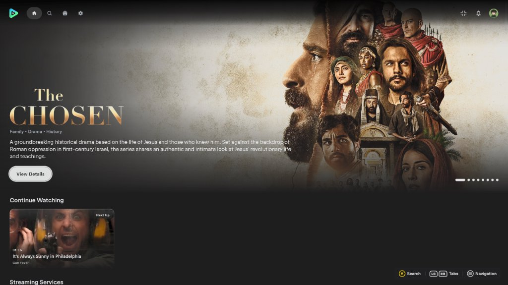
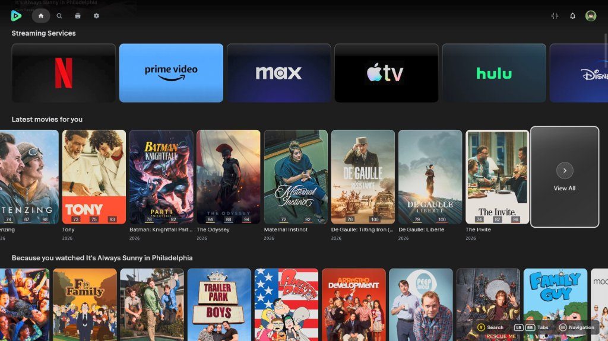
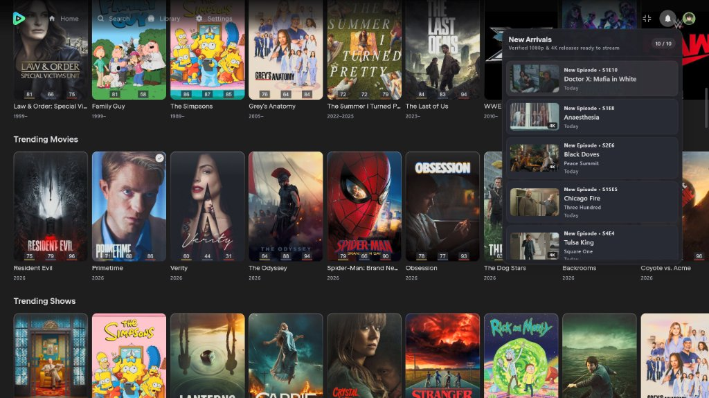
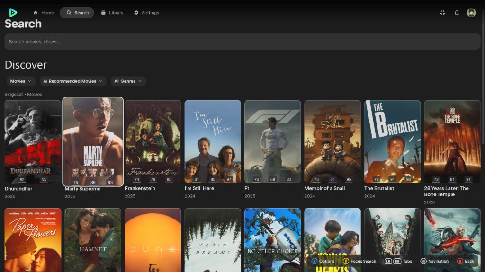
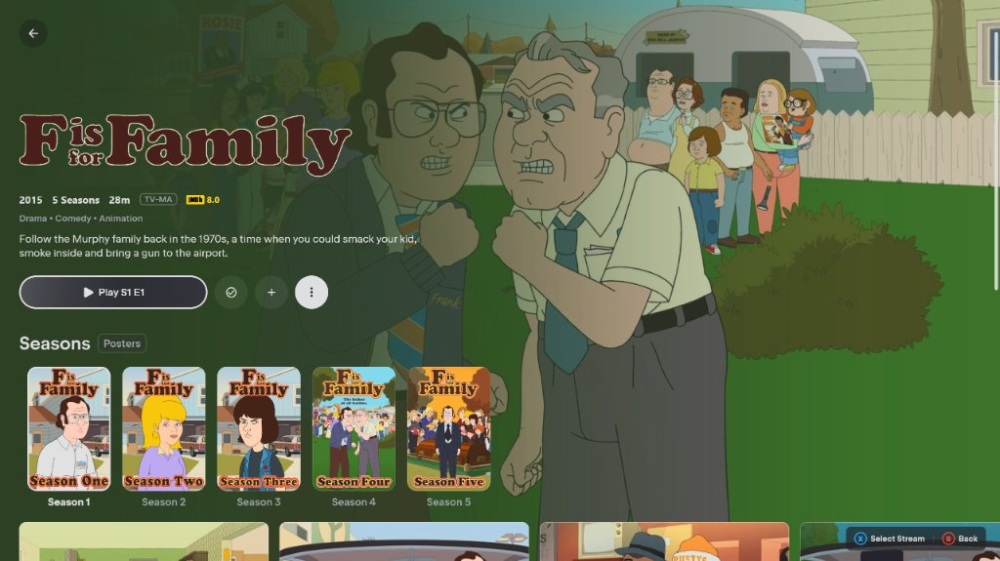

<div align="center">

  

  <br />
  <br />

  <p>
    <a href="https://github.com/kllakm/NuvioDeck/releases/latest">
      
    </a>
    <a href="https://github.com/kllakm/NuvioDeck/releases">
      
    </a>
    
    
    
    <a href="./LICENSE">
      
    </a>
    <a href="https://buymeacoffee.com/enufstyle">
      
    </a>
  </p>

  <p>
    <strong>A free, open-source 10-foot & handheld media center for Windows 10/11.</strong>
    <br />
    Bring your own sources. <strong>NuvioDeck</strong> turns them into a rich streaming library with artwork, ratings, subtitles, and cloud progress sync—purpose-built with native controller navigation for Windows PCs, HTPCs, and handhelds.
  </p>

  <p>
    <a href="https://github.com/kllakm/NuvioDeck/releases/"><strong>⬇ Download Latest Release</strong></a>
    ·
    <a href="https://github.com/kllakm/NuvioDeck/issues"><strong>Report an Issue</strong></a>
    ·
    <a href="https://buymeacoffee.com/enufstyle"><strong>Support NuvioDeck</strong></a>
  </p>

</div>

---

## 📸 Screenshots & Showcase

<div align="center">
  
  <p><em>Full-width Netflix-style Top Navigation Bar over the Hero Banner, Continue Watching shelf, and dynamic Xbox-style Controller Hint Toolbar.</em></p>
</div>

<br />

| **Catalog Shelves & In-Line "View All" Card** | **"New Arrivals" Notification Center** |
| :---: | :---: |
|  |  |
| *Customizable row poster limit (`10–30`, default `15`) with an in-line semi-transparent **View All** poster card, specular cover sheen, and sleek `1.6dp` selection border.* | *10-item FIFO **New Arrivals** dropdown surfacing recently aired watchlist/history episodes and new movies with verified `1080p` / `4K` streams.* |

| **Search & Discover Grid** | **Series Details & Season Selection** |
| :---: | :---: |
|  |  |
| *Seamless D-Pad traversal from the search input and recent searches through Discover filter dropdowns and into the poster grid with synchronized card border scaling.* | *High-contrast inverted **Play** button focus ring, season-poster-only selection borders, and one-press horizontal carousel reveals.* |

---

## 🎮 About NuvioDeck (Windows 11 Controller & Handheld Edition)

**NuvioDeck** is a specialized fork of [NuvioDesktop](https://github.com/NuvioMedia/NuvioDesktop) engineered to deliver a first-class, **native Windows 11 controller, 10-foot living-room TV, and handheld gaming PC experience**—ideal for **ROG Ally**, **Lenovo Legion Go**, **MSI Claw**, **Steam Deck (Windows)**, HTPCs, and desktop setups using Xbox, PlayStation, or Nintendo Switch controllers.

---

## ✨ Key Features

### 🧭 Redesigned Netflix-Style Top Navigation Bar & Auto-Hide Chrome
- **Always-On Floating Top Toolbar:** Replaces the collapsible left sidebar with a full-width (`fillMaxWidth()`) floating top navigation bar across all window sizes.
- **Smooth Black-to-Transparent Vertical Gradient:** Uses a rich top-to-bottom dark gradient (`96%` black at the top edge fading to `0%` transparent at the bottom) with no glass pill clutter behind the icons, ensuring crisp legibility over bright hero artwork.
- **Left, Center & Right Layout:**
  - **Far Left:** Theme-aware Nuvio icon-only graphical mark.
  - **Main Navigation Tabs:** `Home`, `Search`, `Library`, and a dedicated `Settings` tab (decoupled from the profile avatar) with solid filled pill highlights on controller focus.
  - **Far Right Controls:** Dedicated **Fullscreen / Exit Fullscreen** toggle button, **Notification Bell** with unread badge indicator, and **Profile Avatar**.
- **Full 7-Slot Controller & Bumper Tab Order:** Cycle seamlessly through `Home` → `Search` → `Library` → `Settings` → `Fullscreen` → `Notifications` → `Profile` using either D-Pad `Left`/`Right` or the `LB`/`RB` shoulder bumpers.
- **Context-Aware Auto-Hide on Scroll:**
  - **Home Page:** Smoothly slides upward off-screen as soon as you scroll or D-Pad navigate down, and slides immediately back into view when scrolling or navigating up.
  - **Search & Library:** Remains visible until page content scrolls up into the top bar's vertical space.
  - **Settings & Active Focus:** Stays locked in view while browsing **Settings**, while the top bar holds controller focus, or while the Notification/Profile dropdowns are open.

### 🔔 10-Item "New Arrivals" Notification Center & Standalone Profile Switcher
- **Verified "New Arrivals" Detection Engine (`NewArrivalsManager`):**
  - Quiet background service with throttled addon checks (`2.5s` delay between requests) that inspects series in your **Watch History / Continue Watching** and **Watchlist** alongside catalog releases.
  - Enforces a strict recency gate (series episodes aired within the last **7 days**; movies released within the last **120 days**, excluding older trending titles).
  - Verifies that at least one clean **`1080p`** or **`2160p` / `4K`** stream is available right now (automatically filtering out `CAM`, `TS`, `HDTS`, `TELESYNC`, and `SCREENER` sources) before creating a notification.
- **10-Item FIFO Notification Dropdown:** Stores up to 10 notifications in `%APPDATA%\NuvioDeck\new_arrivals_notifications.json` (newest first, automatically dropping the oldest item on overflow) with 16:9 landscape thumbnails, `"New Arrival"` / `"New Episode • SxEx"` / `"Now Available in 4K"` badges, relative timestamps, and direct `A`-button navigation to the title's Details page.
- **Standalone Profile Switcher Dropdown & Sleek Rounded-Rectangle PIN Pads:**
  - Clicking or pressing `A` on the top-right Profile Photo opens an anchored Profile Switcher dropdown with D-Pad `Up`/`Down` navigation and solid highlight fills (zero text clipping).
  - Both the Profile Switcher dropdown and the main Profile Selection screen feature a unified, compact **rounded-rectangle PIN pad** (`RoundedCornerShape(18.dp)` dark studio surface, `"PROFILE PIN"` lock header, recessed 4-dot pill indicator, and a 3×4 controller-navigable key grid with `[X] Delete` and `[B] Cancel`).

### 🎮 Universal Windows 11 Controller Support & Spatial Focus Engine
- **Multi-Backend Hardware Polling & Hot-Plugging:** Low-latency JNA polling across **XInput** (`XInput1_4.dll`, `XInput9_1_0.dll`, `XInput1_3.dll`) and **Windows Multimedia / DirectInput** (`winmm.dll`) with automatic device deduplication and normalization for Xbox, Sony DualSense / DualShock 4, Nintendo Switch Pro / Joy-Con, and built-in handheld controllers.
- **Zero-Friction Auto-Hide Mouse Cursor:** Immediately hides the system cursor (via a `1x1` transparent cursor and Win32 stationary cursor refresh) and clears passive hover states the moment any controller button, trigger, or stick is used—and restores the cursor as soon as the physical mouse moves (`>= 6px`).
- **Selected Artwork Brightening, Specular Cover Sheen & Sleek `1.6dp` Focus Ring:**
  - Focusing a poster or media card with the controller applies a smooth scale-up transition, an subtle brightening wash (`6.5%` white), and a diagonal specular sheen gradient clipped to the card's rounded corners, framed by a refined **`1.6dp` solid white selection border** and diffused outer glow.
  - **Season Poster-Only Selection:** On series detail pages, the selection border and scale effect wrap strictly around the season poster artwork (excluding the `"Season 1"` text label underneath).
  - **Synchronized Discover Card Borders:** Card depth borders in the Discover poster grid scale in lockstep with the selected poster artwork.
- **In-Line "View All" Poster Card & Customizable Row Poster Limit (`10–30`):**
  - Replaces the hard-to-reach header chevron with a full-size, semi-transparent **"View All"** poster card at the end of each catalog row.
  - Includes a persistent **Row Poster Limit** slider (`10` to `30` posters per row, defaulting to **`15`**) under **Settings → Layout → Homescreen**, adjustable via mouse drag or controller D-Pad `Left`/`Right`.
- **Single-Press Horizontal Poster Reveal & Center-Aligned Vertical Scrolling:**
  - Tracks unclipped root-space bounds (`unclippedBoundsInRoot`) so pressing D-Pad `Left` or `Right` toward a partially off-screen poster reveals **100% of the card on the very first press**.
  - Vertically centers the active shelf row (`visualRowCenterY` aligned to `52%` of viewport height) with `FastOutSlowInEasing` and top-boundary clamping so rows glide smoothly into view without judder or overscrolling.
- **Per-Route Focus Memory on Back Navigation:** Remembers the exact focused poster or control for every route (`DetailRoute`, `CatalogRoute`, `TabsRoute`) and restores focus to the show/movie you just exited when pressing `B` to go back.
- **Native Windows 11 Virtual Keyboard & Search History Controls:**
  - Pressing `Y` (or selecting any text input with `A`) scrolls the field into view, commits Compose `FocusRequester` focus, and launches the native Windows 11 touch/gamepad keyboard (`TabTip.exe` / `osk.exe`) so keystrokes always type directly into the search or login field.
  - Full mouse click and controller D-Pad traversal across **Recent Searches**, with `[X]` to delete individual terms and a focusable **Clear** button to wipe search history.

### 🕹️ Xbox-Style Outlined Controller Hint Toolbar & UI Audio
- **Xbox-Style Outlined Button Badges:** Bottom-right floating hint bar featuring unfilled circular outlines (`1.75dp` stroke) with Xbox-colored rings and optically cap-height-centered letters (`A` Green `#38D430`, `B` Red `#FF3B30`, `X` Blue `#2899FF`, `Y` Amber `#FFC800`) and crisp white outlines for `LB`, `RB`, `LT`, `RT`, `View`, and `Menu` inside a translucent dark rounded-rectangle pill (`RoundedCornerShape(8.dp)`).
- **Decluttered Contextual Prompts:** Automatically omits self-evident `A` (Accept/Open) and `D-Pad` (Navigate) hints so only meaningful contextual shortcuts (`[Y] Search`, `[X] Options / Clear`, `[LB][RB] Tabs`, `[Menu] Navigation`, `[B] Back`) are shown.
- **Persistent "App Sounds" Toggle:** Includes a toggle under **Settings → System** (enabled by default) to turn controller and UI navigation sound effects On or Off at any time.

### 🎬 3-Tier Media Player OSD & Streamlined Playback
- **3-Tier Player OSD Navigation:** Full D-Pad spatial traversal across Tier 0 (top header buttons), Tier 1 (timeline seekbar with `10s` step scrubbing), and Tier 2 (bottom transport & modal controls), with the OSD hint toolbar lifted cleanly above the seek bar.
- **Multi-Rail Subtitles Modal:** Smooth horizontal and vertical D-Pad navigation across **Languages ↔ Subtitles ↔ Style** rails without DOM focus loss.
- **Canonical "Continue Watching" & Auto-Stream Playback:**
  - Automatically resolves `tmdb:` IDs, canonical episode `video.id` entries, cached embedded streams, and pending addon manifests when launching directly from **Continue Watching**.
  - Defaults to `StreamAutoPlayMode.FIRST_STREAM` to automatically play the first verified stream source for couch-ready playback.

### ⚡ High-Performance Desktop Engine & Side-by-Side Coexistence
- **Subtle Studio Login Backdrop & Anti-Banding Display:** Clean, star-free dark obsidian-slate studio login background with a smooth `650ms` radial ambient wash tinted by the active profile's accent color, paired with a cached micro-dither brush to eliminate gradient banding on 8-bit/10-bit displays.
- **512MB Persistent Disk Image Cache & High-Refresh VSync:** Okio-backed disk cache (`%LOCALAPPDATA%\NuvioDeck\Cache\image_cache`), hardware trilinear mipmapping (`FilterQuality.Medium`), low-pause G1GC (`-XX:+UseG1GC -XX:MaxGCPauseMillis=16`), and unlocked VSync (`-Dskiko.fps=-1 -Dskiko.vsync=true`) for 90Hz / 120Hz / 144Hz displays.
- **Isolated Side-by-Side Installation:** Uses a dedicated `NuvioDeck` application identity, unique Windows MSI `upgradeUuid`, and isolated data directories (`%APPDATA%\NuvioDeck` and `%LOCALAPPDATA%\NuvioDeck\Cache`) so NuvioDeck and upstream NuvioDesktop can run side-by-side without conflict.
- **Synchronized with Upstream Nuvio Desktop (`v0.1.35`):** Includes upstream Simkl & MDBList ratings, OpenSubtitles video hash computation, custom subtitle font importer, torrent stall auto-resume, smart skip intervals, chapter markers, and multi-language localization.

---

## ⚠️ Alpha Software Notice

NuvioDeck is currently in active alpha development. Features, settings, and storage schemas may evolve between releases. Please report any bugs or controller navigation feedback via [GitHub Issues](https://github.com/kllakm/NuvioDeck/issues).

---

## 📦 Installation & Downloads

Download the latest Windows installer (`NuvioDeck-Windows-x64-0.1.22.msi`) from [**GitHub Releases**](https://github.com/kllakm/NuvioDeck/releases/).

- **Windows 10 / 11 (x64):** MSI Installer (`NuvioDeck-Windows-x64-0.1.22.msi`) or Standalone Executable (`NuvioDeck.exe`)

---

## 🛠️ Build from Source

```bash
git clone https://github.com/kllakm/NuvioDeck.git
cd NuvioDesktop
```

### Run in Development Mode (Windows PowerShell)

```powershell
.\gradlew.bat :composeApp:run
```

### Compile Windows Standalone Executable (`NuvioDeck.exe`)

```powershell
.\gradlew.bat :composeApp:createDistributable "-Pcompose.desktop.packaging.checkJdkVendor=false" --no-configuration-cache
```
The standalone application bundle is generated at:
`composeApp\build\compose\binaries\main\app\NuvioDeck\NuvioDeck.exe`

### Package Windows MSI Installer

```powershell
.\gradlew.bat :composeApp:packageMsi "-Pcompose.desktop.packaging.checkJdkVendor=false" --no-configuration-cache
```
The MSI installer is generated at:
`composeApp\build\compose\release-msis\NuvioDeck-Windows-x64-0.1.22.msi`

---

## 📄 License

Licensed under the [GNU General Public License v3.0](./LICENSE).
