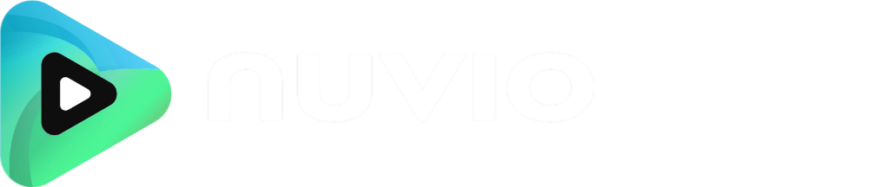

<div align="center">

  

  <br />
  <br />

  <p>
    <a href="https://github.com/kllakm/NuvioDeck/releases/latest">
      
    </a>
    <a href="https://github.com/kllakm/NuvioDeck/releases">
      
    </a>
    <a href="./LICENSE">
      
    </a>
    <a href="https://buymeacoffee.com/enufstyle">
      
    </a>
  </p>

  <p>
    <strong>A controller-first, 10-foot &amp; handheld fork of <a href="https://github.com/NuvioMedia/NuvioDesktop">NuvioDesktop</a> for Windows and Linux.</strong>
    <br />
    Designed for living-room HTPCs, desktops, and gaming handhelds (ROG Ally, Legion Go, Steam Deck, MSI Claw) with full gamepad support.
  </p>

  <p>
    <a href="https://github.com/kllakm/NuvioDeck/releases/"><strong>Download Latest Release</strong></a>
    ·
    <a href="https://github.com/kllakm/NuvioDeck/issues"><strong>Report an Issue</strong></a>
    ·
    <a href="https://buymeacoffee.com/enufstyle"><strong>Support NuvioDeck</strong></a>
  </p>

</div>

---

## Screenshots

<div align="center">
  
  <p><em>Framed Poster Hero banner, My List row, and horizontal landscape Controller Dwell Card.</em></p>
</div>

<br />

| **Inline Dwell Card & Top 10 Shelves** | **New Arrivals & Home Shelves** |
| :---: | :---: |
|  |  |

<br />

<div align="center">
  
  <p><em>Series Details view with IMDb ratings, season tabs, and horizontal episode cards.</em></p>
</div>

---

## Main Features

- **Native Gamepad Navigation (Windows & Linux):** Out-of-the-box support for Xbox, PlayStation, Nintendo Switch, and Steam Deck controllers (`XInput`/`winmm` on Windows, `joydev`/`evdev` on Linux) with automatic cursor hiding, optional controller button hints, UI sounds, and virtual keyboard support.
- **10-Foot Living-Room Interface:** Floating top navigation bar that auto-hides on scroll, framed Poster hero banner, inline controller dwell previews, Netflix-style Top 10 ranked rows, a customizable **My List** home row, and an optional Frosted Glass backdrop.
- **Controller-Ready Video Player:** Full D-Pad navigation across the player OSD (seeking, stream sources, audio tracks, and multi-rail subtitle controls), automatic fallback when streams fail or serve debrid error clips, and a toggleable CAM/telesync release filter.
- **New Arrivals & Release Notifications:** Notification dropdown for recently available HD/4K movies and episodes, plus a **Notify** button on unreleased titles that alerts you once clean streams appear.
- **Side-by-Side Coexistence & Upstream Parity:** Runs alongside upstream NuvioDesktop with isolated settings and cache directories, while staying synced with upstream Nuvio Desktop (`v0.1.38-alpha`) features including Stremio addons, Nuvio plugins, Plex/Jellyfin/Emby/Silo servers, Trakt/Simkl/MDBList tracking, and cloud profile sync.

---

## Installation

Download the latest installers from [GitHub Releases](https://github.com/kllakm/NuvioDeck/releases/):

- **Windows 10 / 11 (x64):** `NuvioDeck-Windows-x64-0.1.34.msi` or standalone `NuvioDeck.exe`
- **Linux (x64):** `NuvioDeck-Linux-x86_64-0.1.34.AppImage`, `.deb`, or `.rpm`

> **Alpha Software:** NuvioDeck is in active alpha development. Please report bugs or controller feedback on [GitHub Issues](https://github.com/kllakm/NuvioDeck/issues).

---

## Build from Source

```bash
git clone https://github.com/kllakm/NuvioDeck.git
cd NuvioDesktop
```

- **Run locally (Windows):** `.\gradlew.bat :composeApp:run`
- **Windows standalone build:** `.\gradlew.bat :composeApp:createDistributable "-Pcompose.desktop.packaging.checkJdkVendor=false" --no-configuration-cache`
- **Windows MSI installer:** `.\gradlew.bat :composeApp:packageMsi "-Pcompose.desktop.packaging.checkJdkVendor=false" --no-configuration-cache`
- **Linux packages (`.deb`, `.rpm`, `.AppImage`):** `./gradlew :composeApp:packageReleaseDeb :composeApp:packageReleaseRpm :composeApp:packageReleaseAppImage -Pcompose.desktop.packaging.checkJdkVendor=false --no-configuration-cache --no-daemon`

---

## License

Licensed under the [GNU General Public License v3.0](./LICENSE).
